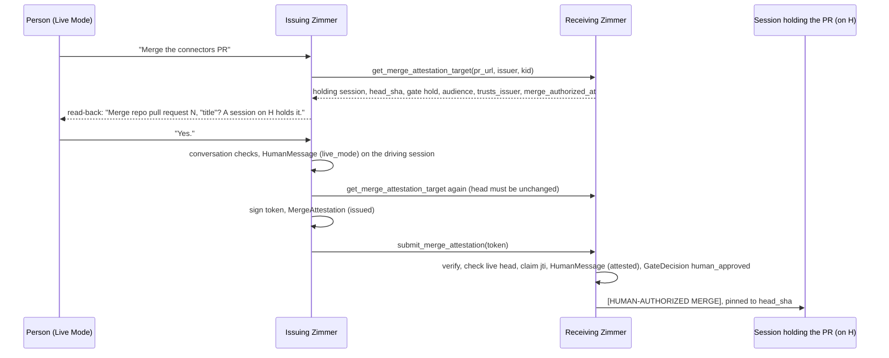

A Zimmer session can drive a session on another Zimmer deployment through that deployment's MCP
server. When the remote session opens a pull request and the remote merge gate holds it for a human,
the human may be talking to *this* Zimmer: in Live Mode, on a phone, in a car. The remote side has no
way to tell a real yes from an agent's text, because any agent can type "the human approved this"
into a follow-up.

So the Zimmer that heard the yes signs it, and the Zimmer that holds the PR checks the signature
before it treats the approval as a person's. The token covers one pull request at one commit, for a
few minutes, once.

This page is the contract between the two sides. Code: `app/services/merge_attestations/`.

## The flow



1. **Prepare.** The live model calls `authorize_merge(session_id, pr_url)` with the session *here*
   that drives the remote one. Zimmer looks for a remote among the MCP servers of that session, its
   ancestors and its descendants, limited to those named in `MERGE_ATTESTATION_REMOTE_SERVERS`. It
   asks each remote `get_merge_attestation_target` until one says it holds the PR, the PR is open
   and green, its head commit, that it calls itself the audience pinned for it here, and that it has
   pinned this Zimmer's current key. Zimmer composes the read-back from that answer. If the remote
   says it has already told the holding session to merge (and that session has not since come back
   unmerged), the person is told so instead of being asked.
2. **Confirm.** `authorize_merge(session_id, pr_url, confirm: true)` runs every check the
   [voice Merge](/sessions/hierarchy-and-human-messages/#merging-by-voice-live_modeauthorize_merge)
   makes on a local PR, unchanged: a fresh question, asked by number, a plain yes from one signed-in
   person, nothing an agent wrote into the conversation. Then Zimmer asks the remote again. If the
   head has moved since the question, it signs nothing. Otherwise it records the yes as a `live_mode`
   HumanMessage on the driving session, signs the token, and hands it to the remote's
   `submit_merge_attestation` from Rails. The live model sees neither the token nor the call.
3. **Receive.** The remote verifies the token, checks the PR's head on GitHub again, claims the
   `jti`, and records the approval. It then sends the holding session the same
   `[HUMAN-AUTHORIZED MERGE]` message the Merge button sends, with the steps pinned to the commit:
   merge with `gh pr merge --match-head-commit <sha>`, and if anything needs a new commit, stop and
   come back to `needs_input`.

## Token format

A compact JWS ([RFC 7515](https://www.rfc-editor.org/rfc/rfc7515)) signed with Ed25519
([RFC 8037](https://www.rfc-editor.org/rfc/rfc8037)).

Header, exactly:

```json
{ "alg": "EdDSA", "typ": "zimmer-merge-approval+jwt", "kid": "<RFC 7638 thumbprint of the signing key>" }
```

Payload:

| Claim | Type | Meaning |
| --- | --- | --- |
| `iss` | string | The issuing Zimmer (`MERGE_ATTESTATION_ISSUER`, default its base URL) |
| `aud` | string | The receiving Zimmer, as pinned for that remote in the issuer's `MERGE_ATTESTATION_REMOTE_SERVERS` |
| `sub` | string | The PR URL, `https://github.com/<owner>/<repo>/pull/<n>` |
| `jti` | string | A random UUID. Single use |
| `iat`, `exp` | integer | Seconds since the epoch. `exp` is `iat` + 300 |
| `ver` | integer | `1` |
| `repo`, `pr_number` | string, integer | Must agree with `sub` |
| `head_sha` | string | The 40-character commit the person approved |
| `approver` | string | The issuer's user key for the person |
| `approver_name` | string | Their display name on the issuer, for the record |
| `channel` | string | `live_mode`, the only channel that mints today |
| `surface`, `heard` | string | `web` / `ios` / `carplay`; `spoken` or `typed` |
| `read_back` | string | The question Zimmer composed and the person said yes to |
| `answer` | string | What the person said |
| `approved_at` | string | ISO 8601 time of the yes |
| `issuer_session_url`, `human_message_id` | string, integer | Where the issuer recorded the yes |
| `remote_session_url` | string | The holding session, as the receiver reported it |

## Keys

- **Issuer.** `MERGE_ATTESTATION_SIGNING_KEY` holds the Ed25519 private key, as a PKCS#8 PEM
  (`openssl genpkey -algorithm ed25519`) or the 32-byte seed in base64url. Unset, the issuer refuses
  the remote path with a sentence that says so. The public key is published at
  `GET /.well-known/merge-attestation-jwks.json` as `{issuer, keys: [JWK]}`, with `kid` set to the
  key's RFC 7638 thumbprint.
- **Receiver.** `MERGE_ATTESTATION_TRUSTED_ISSUERS` is a JSON object keyed by issuer:

  ```json
  {
    "https://zimmer.example.com": {
      "keys": [ { "kty": "OKP", "crv": "Ed25519", "x": "…" } ],
      "approvers": { "issuer-user-key": "local-user-key" },
      "repos": [ "example-org/example-repo" ]
    }
  }
  ```

  `keys` are pinned public JWKs, copied from the issuer's JWKS by whoever configures the receiver.
  The receiver never fetches keys at verify time, so answering the JWKS URL is not a way to become
  trusted. A key's `kid` is recomputed from the key, not read from the config. `approvers` maps the
  issuer's user key to a user on the receiver: an approval from anyone not listed is refused, and the
  record is written as the local user. `repos` is an optional allowlist. `MERGE_ATTESTATION_AUDIENCE`
  names the receiver (default its base URL).
- **Rotation.** Add the new key to the receiver's `keys`, switch the issuer's signing key, then
  remove the old key. Tokens live five minutes, so there is no long overlap to manage.
- **Remotes.** On the issuer, `MERGE_ATTESTATION_REMOTE_SERVERS` lists the catalog MCP servers that
  are other Zimmer deployments, as comma-separated `server=audience` pairs
  (`remote-zimmer=https://remote.example.com`). The audience is pinned here, not taken from the
  remote's answer: a remote that calls itself anything else is refused, so it cannot obtain a token
  addressed to another deployment. Each server's catalog entry must reach the receiver's opt-in
  `merge_attestations` tool group (`?tool_groups=…,merge_attestations`). The issuer calls each tool by the name
  the server lists it under: the exact name, or one ending in `__<tool>`, since a gateway may
  namespace every tool as `<server>__<tool>` and refuse the bare name. No match, or more than one,
  is refused rather than guessed.

## Verification, in order

The receiver (`MergeAttestations::Verifier`, then `MergeAttestations::Acceptor`) refuses at the first
failing step and answers `{accepted: false, code, message}`:

| Step | Refused with |
| --- | --- |
| At most 16 KB, three base64url parts, JSON objects | `malformed` |
| `alg` is `EdDSA` and `typ` is exact; no `crit`, `jku`, `jwk`, `x5u` or `x5c` | `bad_header` |
| `iss` is a pinned issuer | `untrusted_issuer` |
| `kid` is one of that issuer's pinned keys | `unknown_key` |
| The Ed25519 signature verifies | `bad_signature` |
| Every required claim is present; `ver` is 1 | `missing_claims`, `bad_version` |
| `aud` is this Zimmer | `wrong_audience` |
| `iat` is not in the future, `exp` has not passed (30 s skew), and `exp - iat` is at most 10 minutes | `not_yet_valid`, `expired`, `lifetime_too_long` |
| `sub` is a PR URL that agrees with `repo` and `pr_number`; `head_sha` is a SHA | `bad_subject`, `bad_head_sha` |
| The repo is allowed; `channel` is `live_mode` | `repo_not_allowed`, `bad_channel` |
| `approver` maps to a user on this Zimmer | `unknown_approver` |
| An unarchived session here holds the PR, it is open and green, and GitHub says it is open | `not_mergeable` |
| The PR's head on GitHub now is `head_sha` | `head_moved` |
| The `jti` has not been used (a unique insert) | `replayed` |

A token refused before the last step spends nothing and leaves a log line. One that passes writes,
in one transaction, a `received` MergeAttestation, an `attested` HumanMessage on the holding session,
and a `pr_merge` GateDecision with decision `human_approved` and `recorded_via` `attestation`. Then
`Sessions::AuthorizeMerge` delivers the merge message. Only then is the answer `accepted: true`. If
the session cannot take it, the answer is `accepted: false` with code `undeliverable`, the row says
so, and the token stays spent: a new yes mints a new one, and the issuer asks again. The token
parameter (`attestation`) is filtered from the receiver's request logs.

## What each side records

| | Issuer | Receiver |
| --- | --- | --- |
| HumanMessage | `live_mode`, entry point `live_mode.authorize_merge`, on the driving session | `attested`, entry point `attestation.authorize_merge`, on the holding session, with issuer, `jti`, key id, read-back, head SHA |
| MergeAttestation | `issued`: claims, remote, outcome `delivered` or `delivery_failed` with the receiver's reason | `received`: claims, outcome `accepted` or `undeliverable` |
| Gate ledger | — | `human_approved` row for the PR |
| Session log | on the driving session | on the holding session |

`get_session_provenance` on the holding session shows the `attested` record as a signed approval
from the issuer, with the read-back it covered. MergeAttestation rows cannot be deleted, and their
approval columns cannot be changed; only the delivery outcome and the link to the HumanMessage are
written after the insert.

## Threat model

What this defends against, and how:

- **An agent forging an approval.** No MCP tool, REST route or job mints a token. The only caller of
  `MergeAttestations::Issuer.mint!` is `authorize_merge`'s confirm step, and it signs only for a
  `live_mode` HumanMessage it has just recorded on the driving session.
  `test/services/merge_attestations/issuer_test.rb` fails if another caller of the issuer or the
  signing key appears. The live model cannot write the yes: a line an agent types into the
  conversation bars it, as for every Live Mode delivery.
- **An agent relaying a token it saw.** Tokens never reach the model or a transcript, and the
  receiver filters them from its request logs; Rails signs and delivers in the same call. If one leaked, it could only deliver the approval the person gave:
  one PR, one commit, five minutes, once.
- **The PR changing after the yes.** The head is checked at the question, at the yes, on receipt,
  and by GitHub at merge time through `--match-head-commit`. A push in between refuses the token.
- **A token aimed at the wrong place.** `aud` binds it to one receiver, pinned on the issuer per
  remote, `sub` to one PR, and the receiver finds the holding session itself rather than trusting
  the issuer to name one. The issuer also checks that the remote's `repo` and number agree with the
  URL it signs, so what the person hears matches what is signed.
- **Classic JWT mistakes.** One algorithm, fixed `typ`, no key material or key URLs honoured from
  the header, keys pinned in configuration.
- **A compromised or careless issuer.** The receiver limits what it can approve: only mapped
  approvers, optionally only listed repos, and every approval is in the receiver's own ledger.

What it does not defend against:

- **The issuer's own process boundary.** The signing key is in the Rails environment, and agent
  CLIs inherit that environment minus a denylist. The key is on the denylist, so it is not in a
  session's `env`. But agent sessions run in the same container as the same Unix user as Rails, so
  an agent that went looking (another process's environment, the database password) could reach it,
  the same way it could already reach the database and write a HumanMessage. This feature carries
  the issuer's existing trust boundary to the receiver. It does not raise it. See
  [Limitations](/limitations/#signed-merge-approvals-inherit-the-issuers-process-boundary).
- **A mistaken yes.** The person approves what they hear: the repository, number and title as the
  receiver reported them. A remote session's title is that deployment's text.
- **The merging agent ignoring the pin.** The receiver tells the session to merge with
  `--match-head-commit`. Branch protection on the repository is what makes GitHub itself refuse an
  unapproved commit.

## Failure modes

| What happened | What the person hears |
| --- | --- |
| No signing key on the issuer | "this Zimmer has no key to sign approvals for another Zimmer" |
| The session drives no configured remote | "does not drive another Zimmer this one can send approvals to" |
| The remote calls itself something other than its pinned audience | "it calls itself …, not …" |
| The remote does not trust this issuer, or has not pinned its current key | "it does not trust this Zimmer's signing key yet" |
| The remote holds no such PR, or it is red, closed or not yet rated | the remote's reason |
| A push between question and yes | "has a new commit since the person was asked" |
| The remote is unreachable, refuses the token, or verified it but could not deliver the merge message | "Not merged: … refused the approval (reason)"; the issued row says `delivery_failed` |
| The token was already used | `replayed` |
