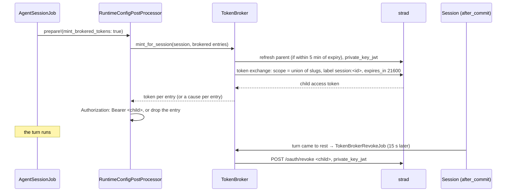

Most remote MCP servers in the catalog authenticate with one long-lived key that every session
carries: the strad entries all send `Authorization: Bearer ${STRAD_API_KEY}`. A session can print it,
and it reaches every server behind the gateway, whatever the session was given.

The token broker replaces that, entry by entry. For an entry that opts in, Zimmer holds one OAuth
grant per authorization server, held by the backend and never written to disk outside the
database. At the start of every turn it exchanges that grant for a **child token** for the
session. The child is scoped to exactly the servers that session has on that authorization server,
labelled with the session id, valid for at most six hours, and revoked when the turn comes to rest.

An entry on the static key and an entry on the broker work side by side in the same session.

## The switch

The broker is **off by default, per deployment**. `ZIMMER_TOKEN_BROKER_ENABLED` turns it on. Unset,
blank and false-like values (`0`, `false`, `f`, `no`, `n`, `off`, `disabled`, any case) are off. Any
other value is on, including one nobody recognises: a misspelling should show up as servers missing
with a cause, not as sessions quietly carrying the static key.

| Switch | A catalog entry that declares `brokered_auth` |
| --- | --- |
| Off | Behaves exactly as it would without the declaration, on every path: the session's MCP config, its secret scope, Zimmer's own calls, the OAuth injector and connector status. Its static header is used. |
| On, and a token can be minted | Gets a child token. Its static header is never used. |
| On, and a token cannot be minted | Is left out of the session, with the cause. Its static header is never used. |

A catalog is shared between deployments, so a declaration alone must not change one that never set
the broker up. The switch is configuration and nothing else. It is deliberately not "the client
identity is configured" or "a grant exists". Those are runtime state, and a lost grant or a KMS
outage must never read as "off" and hand a session the static key.

Every consumer decides through one predicate, `ServersConfig::Server#brokered?` (the entry declares
it, and the switch is on), so they flip together. `declares_brokered_auth?` is for pages that show a
declaration. Revocation and the sweep do not look at the switch, so turning the broker off still
cleans up tokens minted while it was on.

On, an entry also needs Zimmer's
[OAuth client identity](/auth/mcp-oauth/#zimmers-own-client-identity-cimd-and-private_key_jwt)
(`ZIMMER_OAUTH_CLIENT_BASE_URL` and a signing key) and a grant a human connected on the **Token
broker** page (`/token-broker`).

:::caution[A deploy that loses the variable turns the broker off]
Declaring entries then go back to their static header, for as long as the catalog still carries one.
Two surfaces say so: `/token-broker` shows the broker as off with the number of entries declared for
it, and each such row on the Connectors page carries a note. Removing the static header from the
catalog is what closes this for good. Until then the fallback is an operator's configuration change,
never something a session, a grant or an authorization server can cause.
:::

## Cutover

In this order. Each step is safe on its own, and nothing about a session changes before step 4.

1. **Configure the client identity**, and have the authorization server accept it.
2. **Declare `brokered_auth` on one low-risk entry.** With the switch off this does nothing to
   sessions. It comes before connecting because Connect only accepts an authorization server that a
   catalog entry names.
3. **Connect** that authorization server on `/token-broker`. This works while the broker is off: it
   stores the grant and mints nothing.
4. **Turn the switch on**, only once step 3 shows **Connected**. Web and worker must get it in the
   same deploy, so it sits in the environment both roles share (`env.clear` in
   `config/deploy.production.yml`), never on one role. A session that starts after this carries a
   child token for that entry.
5. **Check it**: the entry's row on Connectors is **Ready**, and a session's log says the broker
   minted its token. Turning the switch off again is the way back, as long as the entry still has its
   static header.
6. **Declare the remaining entries**, a few at a time. With the switch on, an entry that gains a
   declaration is brokered from its next turn, so check that its slug is within the grant first.
7. **Remove the static headers** from the declared entries once they have run on the broker.

A deployment that shares a catalog which already declares entries does nothing in step 2. It must
still finish step 3 before step 4, for every authorization server its catalog names.

## Opting an entry in

A top-level `brokered_auth` object on the catalog entry:

```json
"image-diff": {
  "type": "streamable-http",
  "url": "https://strad.tadasant.com/mcp?servers=image-diff",
  "headers": { "Authorization": "Bearer ${STRAD_API_KEY}" },
  "brokered_auth": { "scopes": ["slug:image-diff"] }
}
```

| Field | |
| --- | --- |
| `scopes` | Required. The scope tokens this entry needs; for strad, `slug:<name>`. |
| `authorization_server` | Optional. The origin whose grant serves the entry. Defaults to the origin of `url`. |

The presence of the key is the opt-in, on a deployment where [the switch](#the-switch) is on. It is a top-level key rather than part of `oauth`
because AIR's Claude adapter copies `oauth` into the runtime's `.mcp.json`, which would hand Claude
Code an OAuth configuration for a server Zimmer authenticates itself. A malformed declaration is
still an opt-in: with the switch on, the entry fails visibly instead of falling back.

Only the `Authorization` header is replaced. A static credential in any other header stays on the
entry, so a brokered entry should carry its credential in `Authorization` alone.

The entry may keep its static header while it is cut over. With the switch on, Zimmer never uses it
for a brokered entry: the prepare step deletes it before secrets are resolved, the variable it names leaves the
session's [secret scope](/sessions/spawning/), and the OAuth injector skips the entry. Removing it
from the catalog is still the cleaner end state.

## The one-time consent

On `/token-broker`, each authorization server an entry opts into is listed with **Connect**.
Connect runs the ordinary authorization-code flow with PKCE as Zimmer's hosted client: its
`client_id` is the Client ID Metadata Document URL, and the token endpoint is authenticated with
`private_key_jwt`. The scope is `mcp`, the whole ceiling the authorization server's policy gives
Zimmer's client. The human can narrow it on strad's consent page, and every child narrows it
further. The callback is the shared `/mcp_oauth/callback`, which recognizes a broker flow and stores
an `McpBrokerGrant` rather than a per-entry credential.

Zimmer refuses to start the consent when the authorization server could not serve the broker: no
revocation endpoint, a non-https token endpoint, or no token exchange in `grant_types_supported`.
For strad, the last means its client entry for Zimmer has no `tokenExchange` block yet. A consent
that returns no refresh token is refused rather than stored.

strad needs this client entry (tadasant/strad#537), plus `grants.enabled: true`:

```yaml
- clientId: <zimmer-base>/oauth-client/metadata.json
  tokenEndpointAuthMethod: private_key_jwt
  jwksUri: <zimmer-base>/oauth-client/jwks.json
  tokenExchange:
    childTokenTtlSeconds: 21600
    maxChildTokenTtlSeconds: 21600
```

**Disconnect** queues every live child for revocation, then revokes the grant's refresh token at
the authorization server, which ends every child under it, and forgets the grant. If the
authorization server does not confirm, Zimmer keeps the grant, marks it as needing consent so
nothing mints from it, and keeps revoking its children one by one. Deleting the rows would leave
children nobody can revoke.

## Lifecycle



- **One child per session per authorization server**, its scope the sorted union of the session's
  brokered entries there. Two entries on strad are one exchange and one token.
- **Mint at turn start.** Only `AgentSessionJob` mints, on the fresh-clone and follow-up prepares,
  and on the reused-clone retry path, which otherwise runs no prepare. That last one re-prepares
  only for a session that has a brokered entry. Unarchive, fork, the warm process pool and a
  clone-only job write a config with the brokered entry absent, because no turn is starting. The
  previous turn's child is superseded and revoked.
- **Revoke at rest.** `BrokeredTokenRevocation` enqueues `TokenBrokerRevokeJob` on every rest:
  `needs_input`, `failed` or `archived` from any state, and `waiting` from `running` (a spot hold
  returning a turn to the queue, or a queued message handed straight to the next turn). Two
  transitions are not a rest. `needs_input` reached by an elicitation block leaves the process
  alive. `waiting` from anywhere but `running` is the moment before a turn spawns. The job runs 15
  seconds later and re-checks the session first. It revokes only children minted at or before the
  rest, so a turn that started since keeps its token.
- **Backstop.** `TokenBrokerSweepJob` runs every five minutes. It revokes a child still live while
  its session is at rest, once it is older than 15 minutes, which covers a missed callback or a
  dead worker. It retries failed revocations at 30 s, 2 min, 10 min and then every 30 min, and
  closes a child whose revocation never landed as `expired`. A child that is never revoked stops
  working when it expires, which is the designed fallback.
- **Parent refresh** runs under a row lock and re-reads the row after taking it. strad rotates the
  refresh token on every refresh and treats a replayed generation as theft, so two processes must
  never refresh at once. A refresh that times out or gets a 5xx may still have rotated the token,
  so it is retried once, straight away, while strad's 30-second reuse grace still answers the
  previous generation.
- **Backend children** are minted under the same lock, with the cache re-read after taking it, so
  two processes that miss the cache together do not each mint and revoke the other's.

## When minting fails

With the switch on, the entry is left out of that turn's MCP config. It is never written with the
static key. The cause is named in three places:

- a warning line in the session's log: *"Token broker: MCP server 'image-diff' is unavailable this
  turn because no token broker grant exists for https://strad.tadasant.com yet — a human has to
  connect it once on Zimmer's Token broker page… It was left out of the session rather than given
  a broader credential."*
- `metadata["mcp_degraded_servers"]`, which the session page shows and which is rendered into the
  agent's next prompt, so the agent is told the tools are gone and why. It clears itself when the
  server connects on a later turn.
- the Connectors page and `get_configs`: the entry reports **Broker not ready**, a blocking state,
  so it is not offered to new sessions until the broker can serve it.

The other servers, and the turn itself, run as normal.

| Cause | What the human sees |
| --- | --- |
| No grant yet | "no token broker grant exists for … yet — a human has to connect it once" |
| Grant revoked or expired (`invalid_grant` on refresh) | the grant turns **Needs consent again** on `/token-broker`; "Reconnect it on Zimmer's Token broker page" |
| strad down, `503` | "could not renew …" or "did not issue a token … HTTP 503"; the grant stays usable and the next turn tries again |
| KMS unavailable | the signer's own message; nothing was sent, so nothing was spent |
| Client identity not configured | "Zimmer's OAuth client identity is not configured on this deployment" |
| Scope outside the grant (`invalid_scope`) | strad's own description, which names the slug |
| Invalid declaration | "its catalog entry's brokered_auth declaration is invalid: …" |

## Zimmer's own calls

Rails also calls catalog servers itself: MCP Apps, the live modes' tool bridge, MCP event polling and
subscriptions, and `require_reachable` probes. All of them go through `McpServerEndpoint`. For a
brokered entry it drops the catalog `Authorization` header and uses a backend child, labelled
`zimmer:backend` and scoped to that one entry. A backend child lasts an hour, is reused until ten
minutes before it expires, and is never a session's token. A broker that cannot mint one makes the
endpoint unresolvable, with the cause, the same way a missing `${VAR}` does.

## Keeping the tokens out of logs

- Every secret column is Active Record–encrypted from its first write, with no plaintext column:
  `mcp_broker_grants.access_token` / `refresh_token` and `mcp_brokered_tokens.token`. Encrypted
  attributes are filtered from `inspect`.
- `TranscriptRedactor` adds the grants, and every child that has not been expired for more than an
  hour, to its known-value set. A row that cannot be decrypted costs that row, not the other
  sources. The process that mints a child drops its cached set at once, and every other process picks
  the child up within the set's 60-second rebuild. It also redacts `strad_oat_…` and `strad_ort_…`
  by shape, which covers that window.
- `token`, `subject_token` and `client_assertion` are filtered parameters. Error messages carry only
  the authorization server's `error` and `error_description`, never a response body.
- `/supervisor/mcp_broker_grants` and `/supervisor/mcp_brokered_tokens` are read-only, and show
  each token as `MaskedSecretField` ("set (hidden)"). `/token-broker` shows status, timestamps,
  counts and the last error, never a token.

## Long turns

A turn that outlives its child (six hours) loses the brokered servers until its next turn. The
broker does not solve that. What the runtimes would allow, from reading their shipped code:

- **Claude Code** (2.1.330): `headersHelper` on an MCP entry is a shell command whose stdout is a
  JSON object of headers, merged over the static `headers`. It runs on every connection, so it runs
  again on a reconnect. When a tool call returns 401 (or 403, with a helper configured), Claude
  reconnects, re-runs the helper and retries once. It has a 10-second timeout. Two constraints: for
  a repo-resident config it runs only once the workspace is trusted, and it scrubs
  credential-looking variables from the helper's environment, so a session credential would have
  to reach the helper through a file.
- **Pi** (`pi-mcp-adapter` 2.32.1): a `headers` or `bearerToken` value starting with `!` is run as
  a command on each connection. `requestHeadersCommand` runs before every request. AIR's Pi adapter
  emits neither today.
- **Codex** (0.146.0): no header command. Its streamable-HTTP client can refresh OAuth tokens it
  obtained itself (`codex mcp login`), and `bearer_token_env_var` is read once, at start.

So Claude and Pi could fetch a fresh child from Zimmer on reconnect, through a helper that calls a
session-authenticated Zimmer endpoint. `TokenBroker.mint_for_session` takes no request state, so
such an endpoint can call it directly. Codex would need Zimmer to act as its OAuth authorization
server.

See [Limitations](/limitations/#the-session-token-broker-has-not-run-against-real-strad) for what
has not been exercised.
