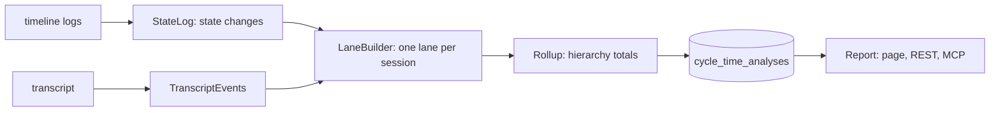

The **Cycle Time** page (`/cycle_times`, between Outcomes and Gate Decisions in the menu) lists the
tasks Zimmer finished on its own and splits each one's wall-clock into what it was doing. Use it to
find where autonomous work is bottlenecked: if most of the time is `Waiting on CI`, CI is the next
thing to invest in. If it's `Worker queue` or `Spot-gate hold`, the bottleneck is Zimmer's own
capacity.

The same numbers are available over MCP (`get_cycle_time`, in the `sessions` group) and REST
(`GET /api/v1/cycle_times`, see the [REST API](/extend/rest-api/#cycle-time)). All three read
`CycleTimes::Report`, so they can't disagree.

## One row is one hierarchy

A task is a **session hierarchy**: a root session (no `parent_session_id`) and every session it
spawned, transitively. Membership follows spawn edges only:

- **Uncle edges are not followed.** An uncle is a senior session that sent a message to a session it
  didn't spawn. It belongs to its own hierarchy and did its own task. Following the edge would merge
  two tasks into one row and count the uncle's time twice. An uncle's follow-up is agent input, so it
  doesn't disqualify the junior's hierarchy either.
- **Status-summary forks are excluded.** They're Zimmer's own bookkeeping, not part of anyone's task.

A row belongs to the window its hierarchy **finished** in (its last archive), so "yesterday's runs"
means the tasks that completed yesterday. A row is counted whole, not clipped to the window: cycle
time is a property of a finished task, dated by its completion, so a task that took three days shows
three days in the 24-hour view of the day it finished. What keeps that honest is eligibility, not
clipping. A task that stalled for weeks because Zimmer failed to wake it is not an autonomous run, so
it gets no eligible row (rule 6 below) and can't take over a window's shares.

## Which hierarchies count as autonomous

A hierarchy gets an eligible row when all of these hold:

1. **Every session in it is archived.** A hierarchy with any session still in flight gets no row at
   all, and loses one it had if a session is restored.
2. **Every archive of every session was done by the task itself**: the session or another session
   in the same hierarchy, over the MCP API or the self-session server, or the REST API. Zimmer reads
   this from the archive line on each session's timeline (`Session moved to trash by …`), which the
   archiving surface writes. The web UI's Trash (single or bulk), a Live Mode archive, one of Zimmer's
   sweeps (stale-session, status-summary), an archive with no recorded actor, or an archive by a
   session **outside** the hierarchy disqualifies it. That last one covers the nightly fleet cleanup
   closing a session that sat parked in `needs_input`: that's a sweep run by an agent, and the task
   didn't archive itself. A single such leaf is enough.
3. **No human spoke after the initiating prompt.** Zimmer reads the
   [human-messages record](/sessions/hierarchy-and-human-messages/) (`HumanMessage`, written only at an authenticated
   input boundary), not message text. The one allowed message is the initiating prompt: a message on
   the **root** recorded no later than two minutes after the root's first turn started. Any other
   human message, on any session in the hierarchy, disqualifies it.
4. **No session was restored from the trash.** A reopened session's span includes its time in the
   trash, and the work after the restore is a second task.
5. **It has at most 300 sessions.** A bigger hierarchy is a runaway, not a task.
6. **No session slept more than an hour past a wake that didn't fire.** A `wake_me_up_later` records
   when it was due. A session still asleep long after that was resumed by something outside the task
   (a restart, a recovery sweep, a person), so the task stalled rather than finished on its own. Its
   wall-clock measures the missed trigger, not the work. The first such row was a gate session that
   armed a one-hour wake on its PR's CI on 2 September, never woke, and was restarted 75 days later.
   It had been counted as 75 days of `Waiting on CI` and made up 75% of the 7-day view.

An ineligible hierarchy still gets a row, carrying the reason (`human_archive`, `system_archive`,
`unrecorded_archive`, `outside_archive`, `human_follow_up`, `reopened`, `too_large`, `missed_wake`). That's what the page's "Not shown"
line and the `ineligible_hierarchies` count report, so "how many tasks were autonomous" has a
denominator.

The initiator is recorded either way: `human` when the root carries an initiating human message,
`trigger` when a Zimmer trigger created the root, `other` otherwise (an API client, or an agent
starting a root session).

## Where the time goes

Each session gets a **lane** running from its `created_at` to its archive. The lane is cut into
segments that tile it exactly, with no gaps and no overlaps, from two recorded sources:

- **The timeline** (`logs`): every state transition writes a `[State Machine]` line (turn started,
  paused, slept, resumed, failed, archived), and the spot gate and the quota parks write their own
  warning lines. `CycleTimes::StateLog` parses them, and `test/services/cycle_times/state_log_test.rb`
  pins the parser to its writers' literal strings, so rewording a log line fails a test.
- **The transcript**, through the runtime's normalizer (Claude Code, Codex and Pi alike): prompts,
  assistant events, tool calls and their results, each with a timestamp.

While a worker has the turn, the lane is cut by transcript events:

| Stretch | Category |
| --- | --- |
| worker start → first transcript event | `turn_startup` |
| prompt or tool result → next assistant event (text, thinking, tool call, compaction, API error) | `inference` |
| tool call → its result | by tool, below |
| last event → the turn's end | `unattributed` (wind-down), or the open tool's category if one never returned |

Parallel tool calls: each stretch between results is charged to the call whose result closes it. A
call whose result was never recorded (an interrupt, a killed process) is closed by the model's next
event a second or more later. Until then the time is the open call's, unless another result arrived
in between, in which case it's `inference`. A turn that an MCP elicitation paused picks up where it
left off when unblocked: the open call stays open and there's no second `turn_startup`.

Tools are classified in one place, `CycleTimes::ToolClassifier`:

| Tool | Category |
| --- | --- |
| Read, Edit, Write, Grep, Glob, TodoWrite, Skill, ToolSearch, any unknown tool | `local_io` |
| WebFetch, WebSearch, every `mcp__*` call | `network` |
| Task / Agent | `subagent` |
| AskUserQuestion | `wait_human` |
| Bash (and Codex `shell`), by command, first match wins: a CI watch (`gh pr checks --watch`, `gh run watch`, a loop polling checks) | `wait_ci` |
| … a `sleep` of 5 seconds or more | `wait_sleep` |
| … `gh`, `git push/fetch/pull/clone`, `curl`, `ssh`, package installs, `docker pull`, cloud CLIs | `network` |
| … anything else (tests, builds, linters, `git status`) | `local_io` |

Between turns, the lane is cut by why the session wasn't running:

| State | Category |
| --- | --- |
| queued for a worker (created, or resumed) | `wait_worker_queue` |
| after a `Spot session held` line, until the next turn | `wait_spot_hold` |
| after a quota-park line (`Quota exceeded across all …`, `No usable … login`, `Provider quota wall`), until the next turn | `wait_quota_park` |
| asleep, until the wake its last turn armed was due | that wake, read by `CycleTimes::WaitClassifier` (below); `wait_sleep` if none |
| asleep more than 15 minutes past that wake's due time | `unattributed` from the due time on ("asleep past its scheduled wake") |
| `needs_input` while one of its children was alive | `wait_child` |
| `needs_input` otherwise, holding a PR it recorded | `wait_merge_gate` |
| `needs_input` otherwise, a root, and nothing resumed it before its archive | `wait_human`: parked on the action queue until something closed it |
| `needs_input` otherwise (later resumed, or a child waiting for its router to close it) | `unattributed`: an agent, a trigger or a person could have resumed it |
| blocked on an MCP elicitation | `wait_human` |
| failed, then revived | `unattributed` |

A `wake_me_up_when_session_changes_state` is `wait_child`, and it beats the `wake_me_up_later`
backstop the skills arm next to it. A `wake_me_up_later` is classified by the prompt the session wrote
for its future self. The vendored skills' exact shapes match first: wait-for-ci's `CI wake N` and
`Blocker wake N` are `wait_ci`, open-pr's `Self-wake N of 3` is `wait_merge_gate`, and its
`post-merge wake N of 10` is `wait_deploy`. After that come free-text patterns for deploys, CI and PR
state, in that order.

The prompt says what a sleep was for only until the wake was due (`wake_at`, in its `timezone`; a
watcher takes its backstop's). Wakes fire within a minute or two, so up to 15 minutes late still
counts as the wake's own wait. Beyond that the session was asleep on a wake that didn't fire, and the
time from the due moment on is `unattributed`. More than an hour of it disqualifies the hierarchy
(rule 6).

### The categories, and why these

| Category | Family | Why it's its own line |
| --- | --- | --- |
| Inference | inference | Model generation. Includes compaction and API retries |
| Network calls | network | Anything waiting on a remote: MCP servers, the web, GitHub, package registries |
| Local I/O & compute | local | File tools and local commands. Test suites dominate it |
| In-process subagent | inference | A Task/Agent subagent the session blocked on. Its own work is inside it |
| Waiting on CI | waiting | The biggest single wait in a survey of 53 recent production transcripts: `gh pr checks --watch` alone held 13 hours of shell time, and every PR session sleeps on `CI wake N` |
| Merge gate / PR holding | waiting | open-pr's `Self-wake N of 3` after the `ready to merge` label, plus `needs_input` while holding a PR |
| Waiting on a deploy | waiting | Recurring in the same survey: open-pr's post-merge wakes on release builds and deploys, up to ten of them per merge |
| Waiting on a child session | waiting | A router watching what it spawned |
| Timed sleep / self-wake | waiting | Any other self-wake or shell sleep |
| Worker queue | waiting | A turn ready to run that no worker thread had picked up |
| Spot-gate hold | waiting | Quota pacing: a spot session held until the window has room |
| Quota park | waiting | Every account out of quota, or the provider refusing |
| Waiting on a human | waiting | Elicitations, and a root session parked in `needs_input` that nothing resumed before its archive. Typically a one-turn answer to a human, left open for them to read |
| Turn startup | overhead | Process spawn, MCP servers booting, the CLI resuming its conversation. It recurs on every turn |
| Unattributed | overhead | Time no recorded event explains. Shown, never spread across the others |

### Overlapping sessions: hierarchy time vs session time

Sessions overlap — a router waits while three children work in parallel — so a hierarchy's breakdown
has two honest readings, and the page shows both:

- **Hierarchy time** (the headline, and what every bar draws): each instant between the first
  session's creation and the last archive is charged once, to the highest-priority category among
  the segments covering it. Work beats waiting (inference > network > local I/O > subagent). If any
  session was working, the task wasn't blocked. Among waits the most specific wins, and
  `wait_child` is last, so a parent waiting on a child is charged to whatever that child was doing.
  An instant no session covers is `unattributed`. **Hierarchy totals sum to the wall-clock exactly.**
- **Session time**: every lane's own totals added up. It's larger than the wall-clock whenever
  sessions overlapped, and it's the right number for "how much inference did this task consume".

So a large `Waiting on CI` in hierarchy time means the whole task was blocked on CI with nothing else
running. The detail page's top lane, **Whole task**, draws the rolled-up hierarchy. The lanes below
it are the sessions, indented by depth.

## When it's computed

Nothing parses a transcript on a page load. `CycleTimes::Analyzer` computes a hierarchy once and
upserts one `cycle_time_analyses` row, keyed on the root:

- **On archive.** Every archive enqueues `CycleTimeAnalysisJob` three minutes later (so the transcript
  poller has ingested the last turn). The job walks to the root and computes it if the hierarchy has
  settled. Otherwise it's a no-op, and the next archive tries again.
- **On a sweep.** `CycleTimeSweepJob` runs every 15 minutes and computes every archived root from the
  last 60 days that has no row, or a row from an older `CycleTimes::Analyzer::VERSION`. This is the
  backfill: after the feature deploys, it works through history one minute per tick, newest first,
  with nobody opening a shell. Bumping `VERSION` re-runs it. The page's "still in flight or not yet
  analyzed" count says how much is left.
- **On restore.** Restoring a session from the trash enqueues the same job right away. The hierarchy
  is in flight again, so its row is deleted.

Rows store per-category totals for both readings, the dominant wait, each lane's segments, the
rolled-up lane, and the 15 segments that cost the most hierarchy time. For drawing, a busy lane's
segments are folded into short-segment buckets: 20,000 segments across the whole hierarchy, split
evenly, between 60 and 1,500 per lane. Every total is computed before that cut.

## Limits

- **The lookback is 60 days**, bounded by [log retention](/operate/background-jobs/#log-retention):
  older timelines have lost the state and archive lines this reads.
- **The REST API's archive counts as an agent's.** It's reached with the fleet's shared API key, but
  the iOS app reaches it too, with no actor recorded that tells the two apart.
- **Only the last turn's wakes are read.** A sleep is explained by the wake its last turn armed. A
  `wake_me_up_later` armed in an earlier turn and still pending isn't seen, so that sleep is a generic
  `Timed sleep` with no due time.
- **A rejected wake still counts.** The classifier reads `wake_me_up_later` calls, not their results, so a call the server refused (a bad `wake_at`) still sets the due time of the sleep that follows.
- **A parked `needs_input` that something later resumed stays `Unattributed`.** The timeline doesn't
  record who resumed it, so it could have been an agent, a trigger or a person.
- **A wake's purpose comes from its prompt text.** A prompt that doesn't follow the skills' shapes
  and doesn't mention CI, a PR or a deploy is a generic `Timed sleep`.
- **Transcript and timeline clocks are written by different processes.** A small skew moves a few
  seconds between `turn_startup`, `inference` and `unattributed`. It never breaks the tiling.
- **PR holding covers the whole session.** A `needs_input` stretch with no live child counts as
  `Merge gate / PR holding` if the session recorded a PR at any point, including a stretch from
  before the PR was opened.
- **Subagents aren't decomposed.** A Task subagent's own inference and tool calls are inside its
  `In-process subagent` segment.
