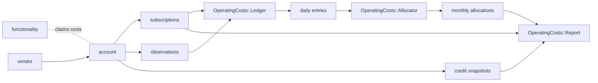

The **Costs** page (`/costs`) is the all-in cost of operating this deployment in real money:
cloud bills, subscriptions, prepaid and promotional credits, data vendors, and the metered spend
Zimmer can see in its own ledgers. It exists so the operator can decide what to cut.

It is not [Token spend](/operate/costs/). That page prices Zimmer's own token ledger at list
rates, and most of those dollars are not a bill: Claude Code and Codex run on subscriptions. The
subscriptions themselves are what appear here.

## What the page shows

Figures run **through yesterday**. The daily collection lands a day's numbers the next morning, so
today is never half-counted.

| Section | What it answers |
| --- | --- |
| Tiles | This month so far, this month projected, last month (with the share that came from real bills), and the forward monthly run rate with its 7-day trend |
| Month by month | Six closed months, this month with its projected rest, and three months ahead, including the month a promotional credit runs out |
| By functionality | What each capability costs. The primary view: each row opens onto the accounts behind it |
| Paid by others | Accounts someone else pays for. Listed so they are not forgotten, kept out of every total unless *Include costs paid by others* is on |
| Credits and run-out | Balance, burn per day, run-out date, expiry, how much of a granted credit is used |
| Subscriptions | Active fixed charges at their monthly equivalent, with renewal dates |
| By vendor, By agent root | The same money by who bills it and by which root it is attributed to |
| Sources and freshness | Per account, how its figures arrive and when the last one did; the latest run of each collector |
| Manage | A form per write, and *Collect now* |

*Only this* on a row narrows the whole page to that functionality, vendor or root. `month=YYYY-MM`
looks at an earlier month. An amber banner appears when the daily job has not succeeded in 36
hours, or a collector's last run failed; the same reasons are on `/health`, in
`GET /api/v1/health` and in `get_system_health`.

## The model

Everything is deployment data. The repository ships no vendor, no account and no functionality;
the daily collection session or a person creates them.



- **Functionality** — a capability the operator would keep or cut. It lists the agent roots it
  claims. An account with no functionality, whose roots no functionality claims, is
  *Unattributed / shared* — a null, never a row.
- **Vendor** — who sends the bill, with its pricing model and how its figures arrive.
- **Account** — one billable thing: a seat, a server, an API project, a credit pool. A bill that
  spans capabilities is split into one account per thing at ingest, so each is a line to cut. An
  account carries `paid_by` (`self`, or who pays it), `zimmer_share` (0–1, for a shared cloud
  account that also hosts something else), an allocation rule, and optionally a `derived_source`.
- **Subscription** — an effective-dated fixed charge, optionally with included usage.
- **Observation** — one money fact as reported: a `daily_cost`, a running `period_to_date`, or a
  closed `invoice`. Never edited in place.
- **Credit snapshot** — a balance on a date: `prepaid`, `promotional` or `plan_included`.

The two derived tables are rebuilt from those and never written anywhere else:

- **Daily entries** (`OperatingCosts::Ledger`) — one row per account per day. For each day the
  highest-precedence fact wins: an invoice spread over its period (billed); a daily cost, or a
  running total minus its latest earlier report in the same period, from anything but Zimmer
  (metered) — a day the total was not reported carries nothing and the next report carries what
  accrued since, so a missed day moves money rather than losing it; Zimmer's own
  derived estimate (estimated); active subscriptions prorated. A plan with included usage charges
  its fee plus only the usage past the allowance. Within a rank, `billing_api` beats
  `card_statement`, `agent` and `manual`. Every amount is multiplied by `zimmer_share`.
- **Monthly allocations** (`OperatingCosts::Allocator`) — each account-month split by agent root
  and functionality. Every breakdown on the page is a group-by over these.

### Splitting an account across agent roots

| Rule | Splits by | For |
| --- | --- | --- |
| `direct_root` | Evenly across `allocation_config.agent_roots` | A cost one root incurs, such as voice |
| `token_spend_share` | Each root's share of list-price token spend that month, optionally one `runtime` | A flat subscription, by who used it |
| `mcp_server_sessions` | Sessions created that month carrying any of `allocation_config.mcp_servers` (or the functionality's), per root | A connector's vendor |
| `unallocated` | Nothing | Shared infrastructure |

A root's share lands in the functionality that claims the root, or the account's own functionality
when none does. A rule with no basis that month (no token spend, no session used the server) falls
back to one unallocated row, so money is never dropped. Zimmer's own ad hoc inference, which has no
root, counts as `zimmer-internal`.

## Projections

- **Forward monthly**: for an account with metered usage, the trailing 28 days' average daily cost ×
  30.44; for an account billed by invoice, the newest invoices' daily rate; for an account with only
  subscriptions, the active subscriptions at their monthly equivalent. The trend uses the trailing
  7 days.
- **This month projected**: month to date, plus the forward rate over the days still to come — and,
  for an account billed by invoice, over the days its next invoice will cover, since an empty month
  before the invoice arrives is not a free one.
- **Credits**: burn is the drop in balance over the trailing 28 days; a rise is a top-up and adds
  nothing. Run-out is balance ÷ burn, capped by the expiry date. A **promotional** credit costs
  nothing until it runs out; from then on its burn is added to each forward month.
- **Renewals**: subscriptions renewing in the next 60 days.

Externally paid accounts are left out of every one of these unless asked for.

## How the figures get in

Two paths, and Zimmer itself never calls a vendor's billing API.

**`OperatingCostsCollectionJob`**, daily at 09:10, needs no secret:

1. Derives what Zimmer's own ledgers show onto the account carrying the matching `derived_source`:
   `live_voice_metered` (metered Live voice events — Claude delegations are subscription-billed and
   not money) and `pi_token_spend` (the Pi runtime's token rows at list price). Days are the app
   time zone's.
2. Rebuilds every account's daily series over the trailing 400 days, so a subscription keeps
   accruing on days nothing was reported.
3. Re-splits the current and previous month.
4. Writes an `operating_cost_collection_runs` row — the "has it run" answer.

It is idempotent: a second run the same day writes nothing new. *Collect now* on the page, `collect_now`
over REST or MCP, runs it immediately.

**The write contract** — everything else: vendor invoices, card charges, credit balances,
subscriptions. A daily agent session (a Trigger row) or a person writes through one action set,
`OperatingCosts::Actions`, from the page's forms, `POST /api/v1/operating_costs/actions`, or
`action_operating_costs`.

### The write contract

`record` takes a batch. It is all or nothing: one invalid item rolls back the batch and the error
names it (`observations[3]: …`). Everything upserts by natural key, so writing the same batch twice
reports every item `unchanged`. References are by key, so one batch can create a vendor, its
accounts and their figures.

```json
{
  "action": "record",
  "collector": "agent:daily",
  "payload": {
    "functionalities": [{ "key": "listing-search", "name": "Listing search", "agent_roots": ["example-root"] }],
    "vendors": [{ "key": "examplecloud", "name": "ExampleCloud", "category": "infrastructure",
                  "pricing_model": "usage", "ingest_method": "agent" }],
    "accounts": [{ "key": "examplecloud-app", "label": "App server", "vendor": "examplecloud",
                   "functionality": "listing-search", "paid_by": "self", "zimmer_share": 1,
                   "allocation_rule": "unallocated" }],
    "subscriptions": [{ "account": "examplecloud-app", "plan_name": "Basic", "amount": 12,
                        "interval": "month", "started_on": "2026-01-01" }],
    "observations": [{ "account": "examplecloud-app", "metric": "invoice", "period_start": "2026-10-01",
                       "period_end": "2026-10-31", "amount": 12.5, "source": "agent",
                       "confidence": "billed", "evidence": "October invoice email" }],
    "credit_snapshots": [{ "account": "examplecloud-app", "as_of_date": "2026-11-16", "balance": 40,
                           "kind": "prepaid", "source": "agent" }]
  }
}
```

| Kind | Identified by | Notes |
| --- | --- | --- |
| `functionalities` | `key` | `agent_roots`, `mcp_servers`, `position`, `active` |
| `vendors` | `key` | `category`, `pricing_model`, `ingest_method` are enums |
| `accounts` | `key` | `vendor` required on create; `functionality` null means unattributed |
| `subscriptions` | `account` + `plan_name` + `started_on` | `interval` month or year; `included_usage_usd` for a plan with credits |
| `observations` | `account` + `metric` + `as_of_date` + `period_start` + `source` | `invoice` needs `period_start`/`period_end`; `raw_payload` is redacted and capped |
| `credit_snapshots` | `account` + `as_of_date` + `source` | `kind` prepaid, promotional or plan_included |

The other actions are `upsert_*` (one `item` of a kind), `end_subscription`, `delete_observation`,
`delete_credit_snapshot` and `collect_now`. Amounts in another currency need `amount_usd` beside
them; Zimmer does no conversion. The `derived` source is the daily job's alone and is refused from
any other writer. On the page's forms a blank field or *(unchanged)* keeps the stored value, so
editing one field of an existing key leaves the rest alone. A `collector` name records the batch as a run, failed batches
included. Every write leaves an `[OperatingCosts]` log line naming the action, its source and the
session.

## Surfaces

| Surface | Read | Write |
| --- | --- | --- |
| Web | `/costs` | Manage forms on the page |
| REST | `GET /api/v1/operating_costs`, `GET /api/v1/operating_costs/records` | `POST /api/v1/operating_costs/actions` |
| MCP (opt-in `operating_costs` group) | `get_operating_costs`, `search_operating_cost_records` | `action_operating_costs` |
| Supervisor | `/supervisor/operating_cost_*`, read-only | — |

`zimmer-operating-costs` and `zimmer-operating-costs-readonly` in `mcp.json` are the catalog
entries for the group. What the page cannot know is listed under
[Known limitations](/limitations/#operating-costs-are-only-as-current-and-as-complete-as-what-was-written).
