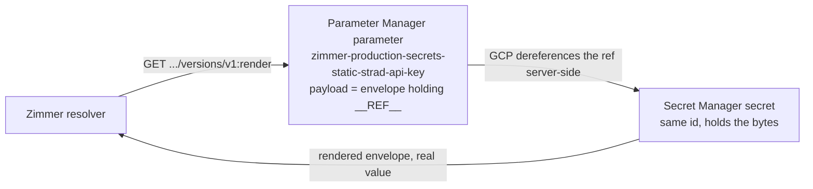

Zimmer resolves the `${VAR}` placeholders in its MCP catalog from a **chain** of
sources. This page covers the first link — Google Parameter Manager + Secret
Manager — what it is for, how to provision it, and how to prove the credential is
the shape it claims to be.

**Zimmer works fine without it.** With no resolver credential configured the
chain is exactly the two links it has always had, the Connectors page says so,
and nothing raises. Wiring the store up is an upgrade, not a prerequisite.

## The chain, and its order

| Order | Source | Where it lives |
| --- | --- | --- |
| 0 | `XOauthTokenVendor` | X access tokens only; ahead of everything because they rotate at runtime |
| 1 | **Google Parameter Store** | `zimmer-secrets-prod`, namespace `/zimmer/{env}/secrets/static/` (and, until the migration finishes, `/zimmer/{env}/mcp/static/`) |
| 2 | Rails encrypted credentials | `mcp_secrets:` in `config/credentials/{env}.yml.enc` |
| 3 | Process `ENV` | the container's environment |

The store goes **first** so migration is one reversible step per secret: write the
value into the store and it takes effect; delete it from the store and the
encrypted-credentials copy is live again. With the order reversed, adding a
secret to the store would do nothing until someone also deleted it from the
credentials file — a change with no visible effect is a change people stop
trusting.

**A miss is not an error.** A provider returns "not here" only when it reached
its backend and the name was not there. A provider that could not reach its
backend *raises*, and the chain does not catch it. Silently falling through to
the encrypted-credentials copy during a store outage is how a rotated credential
comes back from the dead; the credentials link exists to carry secrets that have
not migrated yet, not to paper over an unreachable store.

The Connectors page reflects that distinction directly: a secret the store says
it does not hold is **Missing configuration**, and a secret the store could not
be asked about is **Secret store unreachable**. They are different words because
they call for different actions.

## Not only MCP secrets: `GH_TOKEN`

The chain exists for the `${VAR}` placeholders in MCP server configs, and that is still almost
everything it serves. There are two exceptions today, and they are the reason the
namespace is called `secrets` rather than `mcp` — see [The namespace
rename](#the-namespace-rename-from-mcp-to-secrets).

**`GH_TOKEN`** — the token the `gh` CLI authenticates with — and its per-owner siblings
**`GH_TOKEN__<OWNER>`** are read from this same chain by `GhTokenProvisioner`. It publishes them into the
container's **process environment** at boot and again on every GitHub poll tick, clocked to at most
one chain pass every five minutes. They have to be environment variables rather than resolved
placeholders because most of their consumers are not ours to hand an env hash to: git spawns its
credential helper itself, and spawned agent sessions start from the worker's environment. The
per-owner names are discovered by prefix, so seeding a new `GH_TOKEN__<OWNER>` adds an owner. See
[GitHub tokens: one per repository owner](/operate/provisioning/#github-tokens-one-per-repository-owner).

Two consequences follow from that, both deliberate:

- **It is readable by a session.** A session is handed its own repository owner's token, and anything
  running in it can recover that value with `gh auth token`. Sessions run as the worker's user, so a
  process that goes looking can read the rest of the map from another process's environment too.
  The per-session narrowing is defense in depth, not isolation. So the token is minted on a dedicated non-primary account with least-privilege
  scopes and never `workflow` — see [Staging `gh`
  auth](/operate/provisioning/#staging-gh-auth-the-tadasant-test-account). This is the same
  reasoning that keeps the resolver credential *out* of a session's environment: an address is not a
  credential, and a scoped read token is not a master key.
- **A delete does not propagate; a rotation does.** `ENV` is both where the provisioner writes and
  the chain's last link, so a `GH_TOKEN` removed from the store falls through to the copy already in
  the environment until the process restarts. A new version at the same path — the actual rotation
  path — propagates within the snapshot TTL.

## The namespace rename: from `mcp` to `secrets`

Zimmer's secrets live at:

```
/zimmer/{env}/secrets/static/{VARIABLE_NAME}
```

Two segments doing two different jobs:

- **`secrets`** is the *scope* — whose secrets these are. It used to say `mcp`,
  which was accurate when the chain served nothing but `${VAR}` placeholders in
  MCP server configs. `GH_TOKEN` and `OPENROUTER_API_KEY` are not MCP secrets,
  and they were never going to be the last of their kind, so the segment now says
  what the namespace holds.
- **`static`** is the *kind*, and it is unchanged. It has been there from day one
  so that a future kind (`oauth`, say) is a new prefix rather than a migration of
  every existing path — the property this rename was careful to keep.

The trade is four characters of id budget. `Namespace.parameter_id` folds a path
into a GCP resource id capped at 63 characters, and the canonical prefix
`zimmer-production-secrets-static-` is four longer than the old one, so a
variable name has 30 characters before the fold starts truncating and appending
an 8-character hash of the full path. Every name Zimmer holds today is well
inside that, and the overflow path is deterministic and tested rather than
lossy.

### Why the rename is a data migration and not a string change

The fold from a path to an id is **lossy and one-way**, and the id is embedded in
the `__REF__` the envelope carries. A renamed path lands on a different id:

```
/zimmer/production/mcp/static/STRAD_API_KEY     → zimmer-production-mcp-static-strad-api-key
/zimmer/production/secrets/static/STRAD_API_KEY → zimmer-production-secrets-static-strad-api-key
```

There is no GCP verb that renames a parameter, so moving a secret is **create the
new pair, verify it resolves, delete the old pair** — never an edit in place.

### The resolver reads both namespaces

The code deploy and the data move are separate events, and nobody controls the
order. The chain's contract is that [a miss is not an
error](#the-chain-and-its-order): it falls through to the encrypted credentials
and then to `ENV`. So a resolver reading only the new namespace before the data
moved would not raise — every store-only secret would quietly read as **Missing
configuration**, with the Connectors page the only place it showed, and sessions
would spawn with unresolved `${VAR}`s.

`Namespace.read_namespaces` therefore returns both, canonical first:

| Order | Namespace | Written? |
| --- | --- | --- |
| 1 | `/zimmer/{env}/secrets/static/` | yes — everything writes here |
| 2 | `/zimmer/{env}/mcp/static/` | no — read only, until the migration finishes |

Canonical-first is the same precedence argument the chain itself makes: a value
written to the new path takes effect the moment it lands, rather than waiting for
someone to delete the old copy.

**This costs nothing.** `GcpClient#resolve_all` reads both in one pass, because
the read cost is per *project* — one `parameters.list` plus a `:render` per
managed parameter — and the namespace is a fence applied to the rendered envelope
afterwards. Two namespaces are the same API traffic as one, and a test pins that.

### Telling a half-done migration from a finished one

Because nothing raises either way, the state has to be *reported*. Three surfaces:

- **The Connectors page store banner** names the variables still sitting in the
  pre-rename namespace, or says that nothing does and the old read path can be
  dropped. It reads them off the snapshot the provider already holds, so it costs
  no extra call.
- **Each variable's `GSM` badge** carries the namespace that actually answered for
  *that* variable, in its tooltip.
- **`get_system_health`'s `Secret Store` section** says the same thing to an agent
  session, which cannot read a web page. It names the canonical namespace, the
  pre-rename namespaces still being read, and the sorted list of variable names
  still answering from them — **names only, never values**, because that response
  is read by other agent sessions. It reports off the snapshot the process already
  holds and never refreshes it, so it costs the store nothing even during an
  outage.

That third one is the precondition check for dropping the pre-rename read path, and
it answers in both directions: `none — that read path can be dropped` once the data
has moved, and `none — the namespace migration is complete` once
`Namespace.read_namespaces` returns one namespace. A namespace the process holds no
snapshot of says `unknown` rather than reading as finished, because reporting an
unread namespace as an empty one is the single wrong answer here — it would tell the
follow-up PR to go ahead. `SnapshotCache#get` cannot tell those two apart, which is
why `legacy_variables` reads through `peek` and answers `nil`.

### Running the migration

`ParameterStore::NamespaceMigration` does the four steps per variable — read the
old path, write the new one, verify the new one resolves *through the ordinary
resolution chain fenced to the canonical namespace*, then delete the old pair. It
holds no cursor: every step is decided from what the store holds right now, so a
run that dies halfway is finished correctly by the next one, and a run over a
completed migration does nothing and says so.

It refuses one thing: if both paths hold a variable with **different** values, it
does not choose. The canonical value is the live one, so copying the old copy over
it would silently roll back whatever rotation set it. That variable is reported as
a conflict and left alone.

```bash
# Plan it. Reads both namespaces, prints what it would do, writes nothing.
ZIMMER_PARAMS_PROJECT_ID=zimmer-secrets-prod \
ZIMMER_PARAMS_RESOLVER_SERVICE_ACCOUNT_KEY_JSON="$(cat resolver-key.json)" \
ZIMMER_PARAMS_WRITER_SERVICE_ACCOUNT_KEY_JSON="$(cat writer-key.json)" \
PARAMS_ENV=production \
  bin/rails parameter_store:migrate_namespace

# Do it. Same invocation, plus CONFIRM naming the environment.
CONFIRM=production ... bin/rails parameter_store:migrate_namespace!
```

`PARAMS_ENV` names the namespace's environment, which is **not** this process's
`RAILS_ENV`: migrating production's namespace from somewhere that is not
production is the normal case. `PRUNE=false` stops after the copy, leaving both
copies in place — the safe, fully reversible half-step.

The task refuses to start unless the writer credential's permissions probe says it
can do what the run needs, so a credential that can create but not delete fails
before anything is written rather than halfway through.

### Why this one ships as a rake task

Zimmer's rule is that [ops actions ship with the
deploy](/operate/deploying/#ops-actions-ship-with-the-deploy), and the default
answer to "someone then runs `rake …`" is a post-deploy task. This is the
exception, for the reason the design exists: **Zimmer's resolver credential holds
no write permission**, deliberately and checkably, and it is the one credential
baked into the image. Shipping the migration as a job would mean deploying the
[writer's key](#a-writer-identity-for-the-namespace-migration) into that image to run once —
permanently widening the blast radius of the baked credential to save a human one
command.

So it runs from wherever the writer credential already is. It touches no Zimmer
database and no running process — only Google — so it does not need a shell on the
production box, and should not have one.

### The order a human has to do this in

1. **Widen strad's Secrets Console** to accept the new namespace (below), *before*
   anything writes there. Under `namespacesStrict: true` a path outside the listed
   namespaces is refused outright.
2. **Deploy this change.** The resolver now reads both namespaces, so this is safe
   with the data untouched: every secret keeps resolving from where it already is.
3. **Run the migration**, staging first, dry run first.
4. **Confirm on the Connectors page** that the banner says nothing remains in the
   pre-rename namespace.
5. **Drop the pre-rename read path** in a follow-up PR — a change to
   `Namespace.read_namespaces` and the tests that pin it, and nothing else.

## Why a separate GCP project

**The fence is the GCP project, not the namespace.** `parameters.list` authorizes
on the project parent (`projects/N/locations/global`), whose resource name never
starts with a path prefix, so an IAM condition cannot carry the namespace — it
would deny the very call that matters. The path prefix is a code-level guard;
the project is the boundary.

Zimmer therefore gets **`zimmer-secrets-prod`**, its own project, rather than a
namespace inside strad's `strad-secrets-prod`. The deciding reason:

- Zimmer's resolver needs `secretmanager.secretAccessor` — real secret **value**
  access — because it injects resolved values into MCP server configs at session
  start. strad's MCP-facing viewer identity deliberately lacks exactly that
  permission, and that single omission *is* strad's fence.
- Putting Zimmer's value-reading identity inside `strad-secrets-prod` would hand
  a second application's runtime read access to every strad secret value, which
  inverts that property. It runs the other way too: strad's admin console would
  hold write access over Zimmer's secrets.

The cost is one extra project and three API enablements. That is cheap next to a
shared blast radius.

This holds even under the strategic direction where nearly all of Zimmer's MCP
servers eventually route through strad on a single shared `${STRAD_API_KEY}`: a
shared project would mean a strad compromise reads Zimmer's strad key, and a
Zimmer compromise reads strad's own credentials.

## How a secret is stored

Two resources per secret, joined by GCP itself:



The Parameter Manager payload is an **envelope**:

```json
{
  "path": "/zimmer/production/secrets/static/STRAD_API_KEY",
  "secret": true,
  "value": "__REF__(\"//secretmanager.googleapis.com/projects/zimmer-secrets-prod/secrets/zimmer-production-secrets-static-strad-api-key/versions/latest\")"
}
```

A secret written through strad's Secrets Console carries one more field:

```json
{
  "path": "/zimmer/production/secrets/static/STRAD_API_KEY",
  "secret": true,
  "value": "__REF__(\"//secretmanager.googleapis.com/...\")",
  "encoding": "base64url"
}
```

Four things about it matter:

- **The parameter never holds the secret.** It holds a pointer. A test asserts
  the value appears in no Parameter Manager payload.
- **`versions/latest`** means rotating the secret needs no new parameter version.
- **`path`** is the collision guard. `ParameterStore::Namespace.parameter_id`
  folds a path to a flat, lowercased GCP id, and that fold is lossy — `A_B` and
  `a-b` collapse together. Every read compares the envelope's own `path` against
  the path it asked for, so a resolving id is never mistaken for the right
  parameter.
- **`encoding`** says how the bytes behind the pointer are stored, and the
  resolver honours it. See below.

Only parameters labelled `managed-by=zimmer` or `managed-by=strad` are read.
Zimmer stamps `zimmer` on what it writes. strad's Secrets Console stamps `strad`
on everything it creates, including values it writes into Zimmer's namespace. The
label only keeps a hand-made or foreign parameter from being read at all. The
namespace fence is the envelope's `path`, so a `strad`-labelled parameter for any
other tree in the project is still ignored. A delete accepts either label too.

### The `encoding` field

`:render` does not rebuild the JSON payload — it substitutes the secret's bytes
into the payload **text** and then checks the result for structural damage. A
value carrying a `"`, a `\`, a brace, a bracket or a newline breaks the string it
lands in, and Parameter Manager answers `400 INVALID_ARGUMENT … injection
detected`. A JSON array of token records fails every time.

strad's Secrets Console — the recommended human write surface for this store —
therefore stores every secret's bytes **base64url**, unpadded, and declares it
with `"encoding": "base64url"`. The alphabet is exactly `[A-Za-z0-9_-]`, so
nothing in a rendered payload can have structural meaning. The writer's copy of
that rule is `servers/secrets/shared/src/parameter-wire.ts` in `tadasant/strad`.

Zimmer's resolver reads the field, and each outcome is deliberate:

| `encoding` | What the resolver does |
| --- | --- |
| absent | The literal bytes, unchanged. This is a **documented** state, not an unknown one: every value seeded before the encoding existed is this, and so is everything `ParameterStore::WriteClient` writes. |
| `base64url` | Decoded — and only if the stored bytes really are base64url of valid UTF-8. Standard-alphabet or padded base64 decodes correctly too; a value is never refused for how it is *spelled*, only for not decoding. Bytes that do **not** decode are refused exactly like the row below, and the log line says which of the two it was. |
| anything else | **Refused.** The name is dropped from the snapshot, an error naming the variable is logged, and the Connectors banner lists it as held-but-not-served. |

Refusing is the point. Passing an unrecognised encoding through is how a session
ends up with base64url text where a credential should be — a hit with the wrong
bytes, which no probe catches, on a store where reveal is off so nobody can
eyeball the value either. The refusal drops **one name**, not the resolve: the
chain treats a miss as a miss and falls through to the encrypted credentials,
rather than one bad parameter taking every other `${VAR}` in the project with it.

`ParameterStore::WriteClient` does not write the field — it stores literal bytes,
which the table's first row covers — so a value it writes and a value the console
writes both resolve correctly.

Two consequences of that asymmetry, both recorded in
[limitations](/limitations/#-the-envelope-zimmer-tells-you-to-store-breaks-on-any-secret-containing-a-quote-brace-or-newline):
a value whose bytes carry JSON structure **must not** be stored as literal bytes
— by `WriteClient` or by the [`gcloud` seeding flow](#adding-a-secret) — because
the write lands, the subsequent `:render` 400s, and one such parameter fails the
resolve of the whole project; use the console for those. And
`parameter_store:migrate_namespace` refuses to copy a variable whose pre-rename
envelope declares an encoding, reporting it as `unsupported_encoding`, because it
reads decoded bytes and could only write literal ones; re-seed those at the
canonical path through the console instead.

## Provisioning — a human must do this

**No agent in this deployment can.** There is no `gcloud` on the box and no GCP
MCP server in the catalog; CI holds no IAM-admin credential for this project.
Creating the project, minting the service account and granting roles is a human
prerequisite, exactly as it was for strad's resolver.

Run the whole section in one sitting.

The same is true of the **writer** identity the namespace migration needs — see
[A writer identity, for the namespace migration](#a-writer-identity-for-the-namespace-migration).
No agent can make that grant, and the running app never holds the key.

### 1. The project and its APIs

```bash
PROJECT=zimmer-secrets-prod

gcloud projects create "$PROJECT"
gcloud services enable parametermanager.googleapis.com \
                      secretmanager.googleapis.com \
                      cloudresourcemanager.googleapis.com \
                      --project "$PROJECT"
```

`cloudresourcemanager.googleapis.com` is not optional: the capability probe the
Connectors page shows calls `projects:testIamPermissions` on it. Without it the
page reports "could not confirm what this credential may do" rather than a
capability.

### 2. The resolver identity, and exactly three roles

```bash
PROJECT=zimmer-secrets-prod
SA=zimmer-secrets-resolver
MEMBER="serviceAccount:${SA}@${PROJECT}.iam.gserviceaccount.com"

gcloud iam service-accounts create "$SA" \
  --display-name "Zimmer secrets (runtime resolver: reads parameter + secret VALUES, writes nothing)" \
  --project "$PROJECT"

# List parameters and their versions.
gcloud projects add-iam-policy-binding "$PROJECT" \
  --member "$MEMBER" \
  --role roles/parametermanager.parameterViewer \
  --condition=None

# Actually :render a version. parameterViewer grants the LISTS but NOT render —
# verified the hard way during provisioning, where render 403'd with viewer alone.
gcloud projects add-iam-policy-binding "$PROJECT" \
  --member "$MEMBER" \
  --role roles/parametermanager.parameterAccessor \
  --condition=None

# The other half of a :render — dereference the __REF__ the envelope carries.
gcloud projects add-iam-policy-binding "$PROJECT" \
  --member "$MEMBER" \
  --role roles/secretmanager.secretAccessor \
  --condition=None
```

| Role | Why |
| --- | --- |
| `roles/parametermanager.parameterViewer` | `parameters.list` + `parameterVersions.list` — the two calls `GcpClient#resolve` makes before it renders anything. |
| `roles/parametermanager.parameterAccessor` | `parameterVersions.render`. **`parameterViewer` does not grant this** — with viewer alone the lists succeed and every render 403s, which looks like a working credential right up until nothing resolves. |
| `roles/secretmanager.secretAccessor` | `secretmanager.versions.access`. Not the read path — `:render` dereferences as the *parameter's* principal, so the resolver never calls Secret Manager itself. This is what the [seeding flow](#adding-a-secret) and the audit below assert against. No create, no update, no destroy, no policy read. |

Deliberately **not** granted:

- `roles/parametermanager.admin` / `roles/secretmanager.admin` — that pair is the
  console's admin identity. The resolver never writes, and the one write path in this repo, the
  namespace migration, runs as
  [a separate identity](#a-writer-identity-for-the-namespace-migration) holding
  neither.
- `roles/editor`, `roles/owner` — both grant `versions.access` **and** write.
  Either makes the split decorative.
- `roles/secretmanager.viewer` — metadata-only reads Zimmer never performs.

Bindings are project-level rather than per-secret because a human adds new
secrets at runtime; a per-secret binding set goes stale the moment they do, and
the failure surfaces in production as a `${VAR}` that resolves to nothing.

`--condition=None` only suppresses gcloud's interactive condition prompt; it adds
no binding condition.

### 3. Mint the key

```bash
gcloud iam service-accounts keys create /tmp/zimmer-secrets-resolver.json \
  --iam-account "${SA}@${PROJECT}.iam.gserviceaccount.com" \
  --project "$PROJECT"
```

### 4. Audit it — assert exactly these roles and nothing more

Two halves. The first reads the policy:

```bash
diff <(gcloud projects get-iam-policy "$PROJECT" \
         --flatten="bindings[].members" \
         --filter="bindings.members:${MEMBER}" \
         --format="value(bindings.role)" | sort) \
     <(printf 'roles/parametermanager.parameterAccessor\nroles/parametermanager.parameterViewer\nroles/secretmanager.secretAccessor\n') \
  && echo "OK: the resolver holds exactly the intended roles" \
  || echo "DRIFT: the resolver's bindings are not the intended set (see the diff above)"
```

The second proves the **capability**, which is stronger — it accounts for
anything inherited from a folder or the organisation that a project-level
`get-iam-policy` does not show:

There is **no `gcloud projects test-iam-permissions` subcommand** — call Cloud Resource Manager's REST endpoint directly. This is also exactly what `ParameterStore::Capabilities` calls at runtime, so the audit and the banner are asking Google the same question:

```bash
gcloud auth activate-service-account --key-file /tmp/zimmer-secrets-resolver.json

curl -s -X POST \
  -H "Authorization: Bearer $(gcloud auth print-access-token)" \
  -H "Content-Type: application/json" \
  "https://cloudresourcemanager.googleapis.com/v1/projects/${PROJECT}:testIamPermissions" \
  -d '{"permissions":[
        "parametermanager.parameters.list",
        "parametermanager.parameterVersions.list",
        "parametermanager.parameterVersions.render",
        "secretmanager.versions.access",
        "parametermanager.parameters.create",
        "parametermanager.parameterVersions.create",
        "secretmanager.secrets.create",
        "secretmanager.versions.add",
        "secretmanager.secrets.setIamPolicy",
        "secretmanager.secrets.delete",
        "parametermanager.parameters.delete",
        "parametermanager.parameterVersions.delete"]}' | jq -r '.permissions[]' | sort

# EXPECTED — exactly these four and no others:
#   parametermanager.parameterVersions.list
#   parametermanager.parameterVersions.render
#   parametermanager.parameters.list
#   secretmanager.versions.access
#
# Every MUTATING permission MUST be absent. Their absence is the "reads values,
# writes nothing" claim, checked rather than asserted. If the list comes back
# empty, the SA has no project access at all and something above failed.
#
# `ParameterStore::Capabilities::WRITE_PERMISSIONS` is the same list in code, and
# `Capabilities#least_privilege?` is this assertion at runtime. The namespace
# migration, the one thing that writes, uses a SEPARATE identity — see
# "A writer identity, for the namespace migration" below — precisely so that
# this audit keeps returning the same four.

gcloud config set account <your-own-account>   # switch back off the SA
```

Zimmer runs the same probe continuously: the Connectors page's secret-store
banner reports **least privilege**, **also holds write permissions** (naming
them), **cannot read secret values**, or **could not confirm** — the last being a
distinct state, never reported as a denial.

**"Can read" means `parametermanager.parameterVersions.render`, and only that.**
`GcpClient` lists a namespace and calls `:render` on each parameter; it never
calls Secret Manager directly, so `secretmanager.versions.access` on its own
resolves exactly nothing. The banner requires `render` before it will say a
credential can read — the two used to be ORed, which reported an
access-but-no-render credential as healthy least privilege while every `${VAR}`
came back empty. Render is also *sufficient* on its own: it dereferences a
`__REF__` as the parameter's principal rather than the caller's, which is why the
credential can return a value it holds no `access` on. `versions.access` stays in
the intended grant because [seeding a secret](#adding-a-secret) and the audit
above both depend on it, not because the resolver reads through it.

### 5. Deliver the key to Zimmer

Zimmer reads three environment variables:

| Variable | Value | Sensitive? |
| --- | --- | --- |
| `ZIMMER_PARAMS_PROJECT_ID` | `zimmer-secrets-prod` (staging: `zimmer-secrets-staging`) | No — the store's address is not a credential |
| `ZIMMER_PARAMS_LOCATION` | `global` (the default) | No |
| `ZIMMER_PARAMS_RESOLVER_SERVICE_ACCOUNT_KEY_JSON` | **base64** of the key JSON | **Yes** |

The key is read from `ENV`, deliberately **not** from Zimmer's encrypted
credentials: it is the key to the store meant to supersede that file, and
keeping it there would make rotating it require re-encrypting the very thing it
replaces.

All three are wired in this repo — `config/deploy.production.yml` puts the two
address variables in `env.clear` and the credential in `env.secret`, and
`.kamal/secrets.production` maps it from the deploy environment. The only step
left outside this repo is **setting the GitHub Actions secret**.

#### Base64, and why it is not optional

Encode the key before pasting it:

```bash
base64 -w0 < /tmp/zimmer-secrets-resolver.json
```

Kamal hands env vars to Docker through an **env-file**, which is one line per
variable. Kamal escapes each value with Ruby's `String#dump`, so a real newline
becomes the two characters `\n` — and Docker's `--env-file` parser unescapes
**nothing**, so those two characters arrive literally.

`gcloud iam service-accounts keys create` writes **pretty-printed** JSON. Pasted
raw, it reaches the container with `\n` between its fields and `JSON.parse`
rejects it outright. It is the same constraint that makes `ZIMMER_OPERATOR_SSH_KEY`
base64.

Measured end to end through a real `docker run --env-file`, for one 2048-bit key:

| Pasted as | In the container | Result |
| --- | --- | --- |
| pretty-printed JSON (2367 B, 13 lines) | 2407 B, **1 line** — newlines became `\n` | **rejected**, not valid JSON |
| minified JSON, `jq -c` (2321 B) | 2348 B — only the `\n` escapes doubled | works |
| base64 (3096 B) | 3096 B, unchanged | works |

`ParameterStore::ServiceAccount.parse` accepts base64 **or** raw JSON, so a
minified paste is not a corruption trap and a local `ENV[...]=` in a console still
works. Base64 is what the runbook says because it is the one form that cannot be
got wrong.

**Getting this wrong is quiet.** A credential that will not parse is not a crash:
absence is a designed state, so Zimmer boots, resolves every `${VAR}` from
encrypted credentials exactly as before, and the store simply never turns on. The
Connectors page is where it shows — it names the reason (`… is not valid JSON, nor
base64 of valid JSON`).

#### Set the secret

Two steps, both in the private production repo (`tadasant-internal`), and the
second is a code change rather than a setting:

1. Add the GitHub Actions secret `PROD_ZIMMER_PARAMS_RESOLVER_SERVICE_ACCOUNT_KEY_JSON`.
2. Name it in **both** places `zimmer-deploy-prod.yml` enumerates secrets — the
   `Kamal deploy (production)` step's `env:` block, *and* the `-e` passthrough list
   in the `kamal()` docker wrapper. Consider adding it to that step's
   `: "${…:?}"` assert block too, alongside `PROD_OPERATOR_SSH_KEY`.

The second step is the one that gets skipped, and skipping it is invisible. That
workflow's own comment says why: a var missing from the `env:` block *"would just
arrive empty, and Kamal's `FOO=$FOO` mapping in `.kamal/secrets.production` would
resolve to blank with no error."* Combined with this module's
degrade-rather-than-crash design, the result is a deploy that looks completely
healthy while the store never turns on — the same silent failure as a wrong paste
format, reached by a different route. The Connectors page is where you check.

Then:

```bash
shred -u /tmp/zimmer-secrets-resolver.json
```

#### Staging gets its own project, and one more link than production

Staging is where the store path gets rehearsed before production — the render
join, the per-parameter `secretAccessor` grant, the Connectors banner — so it
reads a store of its own: `zimmer-secrets-staging`, provisioned exactly like the
production project above, with its own resolver service account holding the same
three roles and nothing more.

It is **not** production's. Pointing a throwaway box that agent sessions have root
on at `zimmer-secrets-prod` would hand them a credential that reads production
secret *values*. The two projects also mean two namespaces:
`Namespace.static_namespace` folds in `Rails.env`, so staging reads
`/zimmer/staging/secrets/static/` and cannot see production's.

The wiring is four links. Three are files in **this** repo; the fourth is a
repository setting a human adds:

| Link | Where | Asserted by a test? |
| --- | --- | --- |
| The step's `env:` allowlist | `.github/workflows/deploy-staging.yml`, the `Kamal deploy (staging)` step | yes |
| The Kamal mapping | `.kamal/secrets.staging` | yes |
| The `env.secret` list, plus the address in `env.clear` | `config/deploy.staging.yml` | yes |
| GitHub Actions secret `STAGING_ZIMMER_PARAMS_RESOLVER_SERVICE_ACCOUNT_KEY_JSON` | this repo's settings | no — a test cannot read the repo's Actions secrets |

`test/config/parameter_store_env_delivery_test.rb` asserts all three file-level
links, including the `env:` allowlist — the one the production runbook calls "the
one that gets skipped, and skipping it is invisible". Production's workflow lives
in `tadasant-internal`, so there it can only be written down; staging's is here,
so there it is a test.

:::caution[A second workflow deploys staging too]
`tadasant-internal`'s staging cutover workflow runs its own `kamal deploy` against
this same box, through its own explicit `env:` allowlist. It needs **both** halves
of its own: the `env:` line, and the Actions secret in *that* repo — Actions
secrets are per-repository unless shared at the org or environment level, so an
`env:` line naming a secret the repo does not hold resolves to blank, which is the
failure this whole page is about. Nothing here can see any of it: no test in this
repo reads another repo's workflow.

Neither deploy path delivers the credential for the other. Wire one and the other
still runs degraded — successfully, and silently.
:::

**The credential stays optional, deliberately** — no `:?` assertion anywhere in the
chain. Unset means the store link is simply absent: `SecretProviders.build`
composes `[rails_credentials, env]`, nothing raises, and staging resolves every
`${VAR}` from the committed `staging.yml.enc` exactly as it always has, with the
Connectors page saying the store is not configured rather than reporting a
failure. That is what makes *landing* this wiring a no-op for every credential
already in use, and it is why the address can be wired in `env.clear` before the
secret itself exists.

The fallback does not extend past that, and the difference bites after the secret
is seeded: it is for an **unconfigured** store, not a broken one. Once a credential
is present, a **cold** failure — the first read of a namespace, with no snapshot
held — re-raises, and the chain does not rescue it. A failure with a snapshot in
hand serves the last known good values and warns instead; see [caching and failure
behaviour](#caching-and-failure-behaviour). Unset is a no-op; a cold failure
against a configured store is a hard failure, by design.

The deploy prints which state it is in:

```
✅ Parameter Store ON (resolver key set; reads /zimmer/staging/secrets/static/ and, until the migration finishes, /zimmer/staging/mcp/static/ in zimmer-secrets-staging)
```

### If any CI or deploy step handles this key

Use the leak-safe shape. The GitHub Actions runner prints a step's resolved
`env:` block — **names and values** — in the log-group header *before* the `run:`
body executes, so `::add-mask::` inside the body is always too late. `$GITHUB_ENV`
is worse: the runner folds job-level env into every later step's header.

Write the value to disk under `umask 077` in `$RUNNER_TEMP`, register masks
line-by-line, and put only a **path** in `env:`:

```yaml
- name: Fetch the resolver credential
  id: resolver
  run: |
    set -euo pipefail
    umask 077
    dir="$RUNNER_TEMP/zimmer-params"
    mkdir -p "$dir"
    out="$dir/resolver-key.json"
    gcloud secrets versions access latest --secret "$NAME" --project "$P" > "$out"
    while IFS= read -r line || [ -n "$line" ]; do
      [ "${#line}" -ge 8 ] || continue
      printf '::add-mask::%s\n' "${line//%/%25}"
    done < "$out"
    printf 'file=%s\n' "$out" >> "$GITHUB_OUTPUT"

- name: Use it
  env:
    # A PATH, not the value. Paths are not sensitive.
    RESOLVER_KEY_FILE: ${{ steps.resolver.outputs.file }}
  run: |
    # Split assignment: `export x=$(…)` returns the builtin's status, so a failed
    # `cat` would sail past `set -e` and hand the next step an empty credential.
    KEY="$(cat "$RESOLVER_KEY_FILE")"
    export KEY

- name: Shred it
  if: always() && steps.resolver.outputs.file != ''
  run: rm -f "${{ steps.resolver.outputs.file }}"
```

This is the shape `tadasant-internal` PR #218 landed after the leak tracked in
its issues #215 and #77 — for a key that arrives from somewhere *other* than
`secrets.*`.

`deploy-staging.yml` does not need it. Its key comes straight from
`${{ secrets.STAGING_ZIMMER_PARAMS_RESOLVER_SERVICE_ACCOUNT_KEY_JSON }}`, and
GitHub masks a registered secret's value anywhere in the log, including that
header — which is why the step's preflight reports only whether the credential is
*set*, exactly like the SSH key and the observability secrets beside it. The
leak-safe shape above is for a value the runner fetches or derives, which the
masker has never seen.

## Adding a secret

Zimmer's own credential cannot write, by design. A human with the admin identity
runs, for `STRAD_API_KEY` in production:

```bash
PROJECT=zimmer-secrets-prod
ID=zimmer-production-secrets-static-strad-api-key

# 1. The value itself, in Secret Manager.
printf %s '<the-secret-value>' | gcloud secrets create "$ID" \
  --project "$PROJECT" --replication-policy automatic \
  --labels managed-by=zimmer --data-file=-

# 2. The parameter that indexes it.
gcloud parametermanager parameters create "$ID" \
  --project "$PROJECT" --location global \
  --parameter-format json --labels managed-by=zimmer,secret=true

# 3. Let the PARAMETER read the secret. THIS STEP IS NOT OPTIONAL — see below.
PRINCIPAL=$(gcloud parametermanager parameters describe "$ID" \
  --project "$PROJECT" --location global \
  --format='value(policyMember.iamPolicyUidPrincipal)')
gcloud secrets add-iam-policy-binding "$ID" --project "$PROJECT" \
  --member="$PRINCIPAL" --role=roles/secretmanager.secretAccessor

# 4. The envelope version pointing one at the other.
cat > /tmp/$ID.json <<'JSON'
{"path":"/zimmer/production/secrets/static/STRAD_API_KEY","secret":true,"value":"__REF__(\"//secretmanager.googleapis.com/projects/zimmer-secrets-prod/secrets/zimmer-production-secrets-static-strad-api-key/versions/latest\")"}
JSON
gcloud parametermanager parameters versions create v1 \
  --parameter "$ID" --project "$PROJECT" --location global \
  --payload-data-from-file /tmp/$ID.json
rm -f /tmp/$ID.json
```

**Why step 3 exists, and why omitting it is so hard to diagnose.** `:render`
dereferences the `__REF__` as the **parameter's own** principal
(`policyMember.iamPolicyUidPrincipal`), *not* as the caller's credential. That
principal needs `secretmanager.secretAccessor` on the secret. Without it, every
resolution of that variable fails with `400 SECRET_REFERENCE_ERROR` — while the
Connectors store banner still reports a perfectly healthy credential, because the
banner reflects a `testIamPermissions` probe of the **resolver**, a different
principal. Green banner, nothing resolving. Grant it per secret at creation time.

You do not have to assemble the envelope by hand. **The Connectors page renders
it, with the path and id already filled in**, on any connector whose `${VAR}` is
missing — see [the Secrets Console](#the-secrets-console-and-which-project-it-administers)
below for what else that block says. A test asserts that the envelope the page
emits is the one the client reads back, so the two cannot drift.

To rotate, add a Secret Manager version — the `__REF__` already points at
`versions/latest`, so no new parameter version is needed:

```bash
printf %s '<the-new-value>' | gcloud secrets versions add "$ID" --project "$PROJECT" --data-file=-
```

Zimmer picks a rotation up within the 60-second snapshot TTL, and a newly added
name within the 10-second negative TTL. No redeploy.

## Secrets Zimmer itself depends on

Two values in this store are for Zimmer's own use, not for an MCP server:
`OPENROUTER_API_KEY`, the provider key every Pi session runs on, and
`LIVE_OPENAI_API_KEY`, the OpenAI key behind [`/live`](/sessions/live/#the-openai-key).

**Zimmer does not write to its store.** No page, endpoint or MCP tool creates,
rotates, deletes or reads back a value. A human sets both keys the same way as any
other secret: in the secrets console that administers this store, or with the
`gcloud` commands in [Adding a secret](#adding-a-secret). The path is
`/zimmer/<env>/secrets/static/<NAME>`, for example
`/zimmer/production/secrets/static/OPENROUTER_API_KEY`. A new value reaches Zimmer
within the 60-second snapshot TTL, with no redeploy.

The two pages that depend on a key — the Inference page's Pi tab and `/live`'s
"OpenAI API key" panel — show what `SecretPresence.for` returns and nothing else:

- **Set** or **Not set**, and which link of the chain holds the value ("Resolves
  from"). A store that cannot be consulted reads as Not set, so the page renders
  through an outage.
- The parameter path, from `ParameterStore::Namespace.parameter_path`.
- A link to the console, when one is configured. The wording follows where the
  value came from: "Rotate or delete it" for a value in the store, "It resolves
  from ENV. To keep it in the store instead, set it" for a value from
  credentials or the environment, which the console cannot touch, and "Set it"
  for a missing one.
- With no Parameter Store link in the chain at all, no path and no link: the
  note says the variable is read from Rails encrypted credentials or the
  environment.

There is no value, no fingerprint and no last-set time on either page, because
nothing on them reads the value.

The link comes from `SecretsLocation.store_console`, which reads two variables:

| Variable | What it is |
| --- | --- |
| `ZIMMER_STORE_CONSOLE_URL` | The console that administers **Zimmer's own store**. Unset, the panel shows the path with no link and says to set this variable. There is no default, so a fresh deployment never links somebody else's console. Only an `http(s)://` address counts; anything else reads as unset. |
| `ZIMMER_STORE_CONSOLE_STORE_NAME` | Optional. What that console calls the store, for a console that fronts several. The panel names it next to the link. |

Production sets `ZIMMER_STORE_CONSOLE_URL=https://strad.tadasant.com/ui/secrets`
and `ZIMMER_STORE_CONSOLE_STORE_NAME=Zimmer production` in
`config/deploy.production.yml`'s `env.clear`. These are separate from the
`ZIMMER_SECRETS_CONSOLE_*` triple in [The Secrets Console, and which project it
administers](#the-secrets-console-and-which-project-it-administers). That triple
describes the console over strad's project and is what the Connectors page checks
before it claims a console can set a Zimmer variable. The store-console pair is
the operator saying "this is where Zimmer's own store is administered", so it
carries no project comparison.

### How the key reaches a Pi session

Worth stating, because it is the step it would be natural to assume some other
layer performs. It does not: `SessionEnvFile` writes a clone's `.env` from
`SecretsLoader.all`, which reads Rails encrypted `mcp_secrets` **only** and never
consults `SecretProviders` — so a value living in the Parameter Store does not
land in a session `.env` by that route. (And of the names it *does* read, a clone
receives only the subset its own artifacts declare — see
[What reaches a session clone's `.env`](/operate/provisioning/#what-reaches-a-session-clones-env).)

Every store-backed name reaches its consumer some other way. An MCP config's
`${VAR}` is interpolated by Zimmer before the server is launched. `GH_TOKEN` is
published into the worker's own environment by `GhTokenProvisioner`. Pi has
neither path — it reads the variable out of its own process environment — so
`PiRuntimeAdapter#apply_provider_key` resolves `OPENROUTER_API_KEY`
(`PiAuthProvider::OPENROUTER_API_KEY`) through the chain and puts it in the spawn
environment, **for Pi sessions only**. An inference key authorises spend and a
Claude Code or Codex session has no use for it, so it is not published
process-wide. A value in the clone's own `.env` still wins, like every other step
there.

`OpenaiClient` reads `LIVE_OPENAI_API_KEY` through the same chain.
`CliStatusService` reads `OPENROUTER_API_KEY` through it too, rather than bare
`ENV`, so the CLIs page answers the same question the session will.

## A writer identity, for the namespace migration

Everything above describes a Zimmer that **reads** the store. The one thing in
this repo that writes to it is the [namespace migration](#running-the-migration),
`parameter_store:migrate_namespace`, run from an operator's own shell. It needs a
credential that can create and delete parameter/secret pairs, and that credential
is **not** the resolver's and is **not delivered to the app**: no deploy sets
`ZIMMER_PARAMS_WRITER_SERVICE_ACCOUNT_KEY_JSON` in a Zimmer container.

### Why a second service account, and not a wider first one

The resolver's key is baked into the image and sits on the path every session's
`${VAR}` resolution takes. Granting it write turns one leaked key from "can read
every Zimmer secret" into "can rewrite every Zimmer secret", and it deletes the
property the audit above exists to assert. A separate identity keeps the audit
returning the same four permissions and confines the write blast radius to one
key, held only by whoever runs the migration.

```bash
PROJECT=zimmer-secrets-prod
WRITER=zimmer-secrets-writer

gcloud iam service-accounts create "$WRITER" \
  --project "$PROJECT" \
  --display-name "Zimmer secrets (namespace-migration writer: creates/deletes parameter+secret pairs)"

WRITER_EMAIL="${WRITER}@${PROJECT}.iam.gserviceaccount.com"

# A CUSTOM ROLE holding exactly the twelve permissions the write path calls, and
# nothing else. Every one is traced to a call site in the table below. Do not
# substitute roles/parametermanager.admin + roles/secretmanager.admin — see
# "The broad grant, and why it is not the one to make".
gcloud iam roles create zimmerSecretsWriter \
  --project "$PROJECT" \
  --title "Zimmer secrets writer" \
  --description "Exactly what ParameterStore::WriteClient calls: create, version and destroy Zimmer-managed parameter/secret pairs. Reads no value." \
  --stage GA \
  --permissions parametermanager.parameters.create,\
parametermanager.parameters.get,\
parametermanager.parameters.delete,\
parametermanager.parameterVersions.create,\
parametermanager.parameterVersions.list,\
parametermanager.parameterVersions.delete,\
secretmanager.secrets.create,\
secretmanager.secrets.get,\
secretmanager.secrets.delete,\
secretmanager.secrets.getIamPolicy,\
secretmanager.secrets.setIamPolicy,\
secretmanager.versions.add
# Re-running? `roles create` fails with ALREADY_EXISTS. Use `gcloud iam roles
# update zimmerSecretsWriter --project "$PROJECT" --permissions <same list>`.

gcloud projects add-iam-policy-binding "$PROJECT" \
  --member "serviceAccount:${WRITER_EMAIL}" \
  --role "projects/${PROJECT}/roles/zimmerSecretsWriter" --condition=None

gcloud iam service-accounts keys create writer-key.json \
  --iam-account "$WRITER_EMAIL"
# -> ZIMMER_PARAMS_WRITER_SERVICE_ACCOUNT_KEY_JSON="$(cat writer-key.json)" for the
#    migration run. Delete the file, and revoke the key, when the run is done.
```

**The role grants no verb that returns a value.** It holds neither
`parametermanager.parameterVersions.render` nor `secretmanager.versions.access`,
the two permissions that turn a name in this store into bytes. `WriteClient`
calls neither, and the
[audit above](#4-audit-it--assert-exactly-these-roles-and-nothing-more) asserts
they belong to the resolver. The writer cannot resolve this store the way Zimmer
does. The migration's verify step reads back through the resolver, not the writer.

**Treat it as a read-capable credential anyway.**
`secretmanager.secrets.setIamPolicy` is load-bearing — it is the step that lets a
parameter dereference its own secret — and a project-level holder of it can bind
itself to `roles/secretmanager.secretAccessor` on any secret here and then read
what it likes. The ids are derivable, and the bytes are all in Secret Manager. So
the honest claim for the custom role is narrower than "cannot read": reading
takes a deliberate policy mutation, which lands in the secret's own IAM policy
and in Cloud Audit Logs, instead of being a permission the credential already
sits on. A leaked writer key is at least as urgent as a leaked resolver key, and
it can also destroy things. Mint it for a migration and revoke it after.

`CliSpawnEnv` clears `ZIMMER_PARAMS_WRITER_SERVICE_ACCOUNT_KEY_JSON` from every
spawned agent session even though no deploy sets it: a process that somehow holds
it must not pass it on, because a session holding the writer key could rewrite or
delete every Zimmer secret, and grant itself the read of every one.

Staging gets its own writer if it gets one at all. A credential that may *delete*
secrets is the last one to share across environments.

### The broad grant, and why it is not the one to make

`roles/parametermanager.admin` + `roles/secretmanager.admin` at the project level
is the one-line grant, and it works. It is also the grant this same document
spends [the resolver's section](#2-the-resolver-identity-and-exactly-three-roles)
arguing against for the other identity, and the reasoning does not stop applying
because the principal changed:

- Both roles carry the **read** verbs outright. `parametermanager.admin`
  includes `parameterVersions.render`, `secretmanager.admin` includes
  `versions.access`, and between them that is every value in
  `zimmer-secrets-prod`, readable with no policy change and nothing in the audit
  log to distinguish it from ordinary use. The write path never reads a value,
  so this is power granted to a credential with no use for it.
- They carry write verbs Zimmer does not call either, `secretmanager.secrets.update`
  and `secretmanager.versions.destroy` among them, and the rest of two whole
  surfaces besides.

Use them only as a deliberate, temporary shortcut — while diagnosing a permission
problem, say — and replace them with the custom role before a live run.

### Why the binding is project-level

The migration drives `WriteClient` over **every** variable in the store
(`ParameterStore::NamespaceMigration` upserts at the canonical path and deletes at
the pre-rename one), so a binding scoped to particular parameters cannot cover it.
Two more reasons hold even for a single pair:

1. **Two of the permissions are parent-scoped by construction.**
   `parametermanager.parameters.create` and `secretmanager.secrets.create` are
   checked against the *parent* — the project, and for Parameter Manager the
   project's location, neither of which is a per-secret handle. `WriteClient#upsert`
   creates the pair, so on a first write there is no resource to have bound them to.
2. **The preflight asks the project.** `Capabilities.probe` calls
   `projects:testIamPermissions` on Cloud Resource Manager
   (`WriteClient#held_permissions`), which reports permissions held on the
   *project* — including any inherited from a folder or the organisation, but not
   ones granted on a child resource. A permission bound only to a parameter is
   invisible to it, so `can_upsert?` stays false and `MigrationTask` refuses a
   live run before anything is written.

So the resource scope stays project-wide and the *permission* set is what gets
cut — from two full admin surfaces to twelve verbs, none of which reads a value.
That is the same trade-off the resolver makes, for a
[related reason](#2-the-resolver-identity-and-exactly-three-roles): a binding set
pinned to today's resources goes stale the moment a human adds a secret.

### The permissions, and what each one is for

Twelve permissions, each traced to the call in `ParameterStore::WriteClient` that
needs it. This is the union of `ParameterStore::Capabilities::UPSERT_PERMISSIONS`
and `DELETE_PERMISSIONS`. `MigrationTask` checks them separately: a live run
refuses without `can_upsert?`, and refuses without `can_delete?` unless
`PRUNE=false`, so a role holding only the nine upsert permissions can still do the
copy-only half-step. (`Capabilities.probe` asks about fourteen, not twelve — it
adds `parameterVersions.render` and `versions.access` so a credential that holds
them can be reported.)

| Permission | Called by |
| --- | --- |
| `secretmanager.secrets.create` | `create_secret` — the secret that holds the bytes. 409 is tolerated, which is the rotation case |
| `secretmanager.versions.add` | `add_secret_version` — writing the value, and the *only* call a rotation makes, because the envelope points at `versions/latest` |
| `secretmanager.secrets.getIamPolicy` | `grant_accessor` — reading the policy so the binding is merged, not replaced |
| `secretmanager.secrets.setIamPolicy` | `grant_accessor` — **the step that fails silently if skipped** — granting the parameter's own principal `roles/secretmanager.secretAccessor` |
| `secretmanager.secrets.get` | `refuse_unmanaged!`, on delete — checking the `managed-by` label (`zimmer` or `strad`) before destroying anything |
| `secretmanager.secrets.delete` | `delete` — removing the secret |
| `parametermanager.parameters.create` | `create_parameter` — the parameter that indexes the secret |
| `parametermanager.parameters.get` | `create_parameter`, reading `policyMember.iamPolicyUidPrincipal` off an existing one; and `refuse_unmanaged!` on delete |
| `parametermanager.parameterVersions.list` | `parameter_version_ids` — deciding whether the envelope still needs writing, and enumerating versions to delete |
| `parametermanager.parameterVersions.create` | `write_envelope` — the envelope joining parameter to secret |
| `parametermanager.parameterVersions.delete` | `delete` — Parameter Manager refuses to delete a parameter that still has versions, so these go first |
| `parametermanager.parameters.delete` | `delete` — removing the parameter |

Two places where the probe and the call sites do not line up exactly. Neither
changes the role above, because it is the union of both lists, but both are worth
knowing if you ever narrow it further: `secretmanager.secrets.get` sits in
`UPSERT_PERMISSIONS` although `upsert` never issues that GET (it POSTs the create
and tolerates 409) — the call is on the delete path; and `DELETE_PERMISSIONS`
omits `secrets.get` and `parameters.get` although `refuse_unmanaged!` calls both.

No permission on Cloud Resource Manager is needed for the probe itself, but
`cloudresourcemanager.googleapis.com` must be enabled on the project — see [the
project and its APIs](#1-the-project-and-its-apis).

## The Secrets Console, and which project it administers

A Parameter Manager project can have a **Secrets Console** in front of it — a
web UI with create, reveal and rotate, behind Workspace SSO. It is a far better
thing to point a person at than the four commands above, and the Connectors page
points at one.

**One console administers exactly one GCP project, in one location, and that is
the whole subtlety.** `SecretsLocation::CONSOLE_URL`, `CONSOLE_PROJECT_ID` and
`CONSOLE_LOCATION` are stored as a triple for that reason, and the Connectors
page compares the last two against the store its resolver is actually reading
(location as well as project — a parameter is addressed by both, so the right
project in the wrong location is the same silent failure one field further down):

| Console administers | What the row says |
| --- | --- |
| the project Zimmer resolves from | "Set it in the Secrets Console" — four UI steps, no shell at all |
| a different project | the link, plus a plain statement that a value saved there **will never reach this variable**, and the envelope for creating it with the admin identity |
| nothing (no resolver configured) | the link, plus "the console holds none of Zimmer's variables right now" and the `mcp_secrets` path |

**Today the second row is the live one.** The console at
`https://strad.tadasant.com/ui/secrets` administers `strad-secrets-prod`;
Zimmer's store is `zimmer-secrets-prod`, deliberately a separate project (see
[Why a separate GCP project](#why-a-separate-gcp-project)). A value typed into
that console for a Zimmer `${VAR}` is accepted, saved, and never read — the
variable goes on reporting **Missing configuration** with nothing to explain why.
That silent failure is what the comparison exists to prevent, and it is why the
page must never flatten this to "set your secrets in the console".

All three are overridable — `ZIMMER_SECRETS_CONSOLE_URL`,
`ZIMMER_SECRETS_CONSOLE_PROJECT_ID`, `ZIMMER_SECRETS_CONSOLE_LOCATION` — so that
pointing at a Zimmer-scoped console, if one is ever stood up over
`zimmer-secrets-prod`, is configuration rather than a deploy of new copy. They are
read as **one unit**, and a partial override is ignored rather than merged: setting
the project without the URL would otherwise render the green "set it here" box
pointing at a console that administers something else, which is the exact failure
the pairing exists to prevent. The failure mode of a half-finished override is
"no console claimed", never a wrong one.

### The other credential, on a gateway-hosted server

A server Zimmer reaches through a gateway has **two** credentials in two places,
and a row for one of them says so:

- the `${VAR}` on the row — Zimmer's own bearer token for the gateway, in Zimmer's
  store;
- the credential the gateway presents upstream, under the server's own slug in the
  console's project.

The console administers the second and never the first, so fixing the one that is
easier to reach leaves the row exactly as it was. The row names both. It also
notes that the gateway's own store is a **registry rather than a delivery path**
today — the gateway still resolves its credentials at deploy time, so a value
saved there is recorded, not shipped.

"Is this server behind the gateway" is keyed on `SecretsLocation::GATEWAY_HOST`,
**not** on the console's own host, even though they are the same host today. The
console URL is overridable precisely so it can be replaced; deriving the gateway
from it would make this note silently disappear from every row that still has a
second credential the moment someone did.

## Caching and failure behaviour

Reads are cached as a **whole-namespace snapshot**, not per key: resolving the
namespace is one list plus a render per parameter, so per-key caching would turn
one page render into N listings.

- **Single flight** — concurrent readers share one refresh.
- **Stale on error, only when a value is held.** A refresh that fails while
  values are held serves the last known good ones and logs a warning. A *cold*
  failure re-raises: pretending an unreachable store is an empty one turns an
  outage into "that secret does not exist".
- **Failure backoff** — 5s, so an outage is not retried on every request.
- **Generation counter** — an `invalidate` during an in-flight refresh discards
  that refresh's result, so a write is never masked by a read that started before
  it.

Nothing logs a secret value. Error summaries carry the exception class, and a
message only when it is a `ParameterStore::StoreError` (whose messages name a
resource and never quote a response body — on the render and access verbs, that
body *is* the secret).

## What has to change outside this repo

Staging needs two things from outside this repo's files, and they gate different
deploy paths rather than stacking. `STAGING_ZIMMER_PARAMS_RESOLVER_SERVICE_ACCOUNT_KEY_JSON`
in this repo's Actions secrets is what `deploy-staging.yml` needs; until it is set,
*every* staging deploy runs with the address wired and the credential blank — the
designed degraded state, and what the preflight line reports. `tadasant-internal`'s
staging cutover workflow needs its own `env:` passthrough and its own copy of the
secret; until it has them, deploys down **that** path stay degraded even after this
repo's are not.

**The Secrets Console's namespace allowlist** is the other one, and the namespace
rename gates on it. `strad/infra/strad.prod.yaml` in `tadasant-internal` pins each
store entry's `namespaces:` with `namespacesStrict: true`, and Zimmer's two entries
list only `/zimmer/production/mcp/` and `/zimmer/staging/mcp/`. Under strict, a path
outside those is refused — so until both entries list the new prefix **as well as**
the old one, the console cannot write a single new-namespace path:

```yaml
# zimmer-secrets-prod
namespaces: ["/zimmer/production/secrets/", "/zimmer/production/mcp/"]
# zimmer-secrets-staging
namespaces: ["/zimmer/staging/secrets/", "/zimmer/staging/mcp/"]
```

Both, not either: during the transition the console has to reach the old paths to
read and remove them, and the new ones to write them. That file belongs to the
`strad-production` root, not this one.

The rest live in `tadasant-internal`'s `zimmer/` root and need a human:

1. **The GitHub Actions secret, and the deploy workflow edit** —
   `PROD_ZIMMER_PARAMS_RESOLVER_SERVICE_ACCOUNT_KEY_JSON` (base64,
   [above](#base64-and-why-it-is-not-optional)), then naming it in **both** of the
   places `zimmer-deploy-prod.yml` lists secrets: the Kamal step's `env:` block and
   the `kamal()` wrapper's `-e` passthrough. See
   [set the secret](#set-the-secret) — the second edit is easy to miss and fails
   silently. These are the last links; the Kamal mapping and the `env.secret` /
   `env.clear` entries are all in *this* repo now.
2. `zimmer/DEPLOY.md` — a row in the "One-time secrets" table for that secret.
3. `zimmer/CREDENTIALS.md` — the four-row mechanism table at the top gains a
   fifth mechanism, and §1's "SecretsLoader reads from exactly one place" needs
   rewriting now that a chain sits in front of it.
4. **Rotation tooling** — `zimmer/scripts/prod-secrets.sh` and
   `fingerprint-mcp-secrets.rb` operate on the encrypted credentials file; a
   store-backed secret sits outside both, so the "proof it landed" story needs an
   analogue. The Connectors page is the interim answer: it reports presence per
   variable, without values.
5. **The writer key, out of the deploy wiring.** No Zimmer container receives
   `ZIMMER_PARAMS_WRITER_SERVICE_ACCOUNT_KEY_JSON` — this repo's `.kamal/secrets.*`,
   `config/deploy.*.yml` and `deploy-staging.yml` do not map it. So the GitHub
   Actions secrets `PROD_ZIMMER_PARAMS_WRITER_SERVICE_ACCOUNT_KEY_JSON` (and any
   passthrough of it in `zimmer-deploy-prod.yml`, which lives in
   `tadasant-internal`) and `STAGING_ZIMMER_PARAMS_WRITER_SERVICE_ACCOUNT_KEY_JSON`
   (in this repo) can be deleted. Once no namespace migration is pending, revoke
   the writer service account's key too; mint a fresh one for the next migration.

## When it does not resolve

| Symptom | Cause |
| --- | --- |
| `400 SECRET_REFERENCE_ERROR` on `:render` | The parameter's own principal lacks `secretmanager.secretAccessor` on the secret — step 3 of the seeding flow was skipped. The store banner will still be green; it probes the resolver, not the parameter. |
| `403` on `:render`, lists succeed | The resolver holds `parameterViewer` but not `parameterAccessor`. The banner reports this as **cannot read secret values**, naming `parameterVersions.render` — holding `secretmanager.versions.access` without it resolves nothing. |
| Banner says "could not confirm what this credential may do" | `cloudresourcemanager.googleapis.com` is not enabled on the project. |
| Every variable reads `Unresolved`, no error | The namespace is empty, or the parameters carry neither the `managed-by=zimmer` nor the `managed-by=strad` label, or their envelope `path` falls outside the namespaces the resolver reads (`/zimmer/{env}/secrets/static/`, plus `/zimmer/{env}/mcp/static/` until the migration finishes). |
| One variable reads `Unresolved`, and the banner lists it under **Held but not served** | Its envelope declares a value `encoding` this Zimmer does not implement, so the resolver refuses to serve bytes it cannot vouch for. Upgrade Zimmer, or re-seed the value through a writer that stores `base64url`. |
| A session authenticates with what looks like a valid credential and the upstream rejects it | On a Zimmer that honours `encoding`, this is not the envelope. On one that does not, a console-seeded secret resolves as its base64url text and every surface still reports success — the failure [zimmer#999](https://github.com/tadasant/zimmer/issues/999) describes. |

## Testing without GCP

`test/support/fake_parameter_store.rb` is an in-memory Parameter Manager +
Secret Manager behind the HTTP seam. It is deliberately a fake **transport**, not
a fake client: the code under test is the production
`ParameterStore::GcpClient`, so envelope decoding, the `:render` join, the
namespace fence and pagination all stay covered. `parameter_payloads` exposes
every payload ever written, which is what the "the secret never touches a
Parameter Manager payload" canary asserts against.

**No Zimmer process has yet resolved a real secret.** This deployment has no
`gcloud` and no GCP credential, so no agent here could exercise the live path.
What is proven is the chain, its precedence, the degraded-state fallback, the
cache semantics, the envelope round-trip, the help text, and — through a real
`docker run --env-file` — that a base64 credential survives Kamal's escaping into
the container while pretty-printed key JSON does not. The provisioning above is
done; the first live run happens when the GitHub Actions secret is set.
