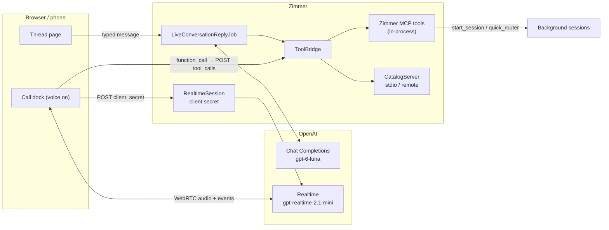

A session is an agent working on one job. Sometimes you want something else: to think out loud, ask
what is going on, and kick off work as it occurs to you, without writing a prompt for each piece.
That is what Live Mode is for. It is **one continuous conversation** with a fast model that answers
quick things itself and hands anything slower to Zimmer's own [MCP surface](/extend/mcp-server/).
It starts a background session, says that it has, and checks back on it when you ask.

You can type or talk. Voice is not a separate mode with its own thread: **Enable voice**, next to the
composer, turns voice on in the conversation you are in, and **Type instead** turns it off again.
The thread carries both. Spoken turns are transcripts beside the typed ones.

| | Typed | Voice on |
| --- | --- | --- |
| Model (default; [tunable](#live-settings)) | `gpt-6-luna`, Chat Completions, `reasoning_effort: "none"` | `gpt-realtime-2.1-mini`, Realtime API |
| Where it runs | a job on the server | the browser's WebRTC or the phone's WebSocket connection to OpenAI |
| How it answers | longer answers, lists, snippets, links, light markdown | short spoken turns, nothing read out that is meant to be seen |
| Agent root | `live-mode` | `live-mode` |

You enter it from the main screen: **Live Mode** beside **New Session**, or the chat button and the
menu on a phone. `/live` has it as well, plus whether the OpenAI key is set.

## One conversation

Live Mode has one current conversation. Opening it resumes that conversation; **New conversation**
ends it and starts a fresh one, typed. An ended conversation can be gone back to, which
[moves which one is current](#going-back-to-a-conversation) rather than opening a second. The
database enforces this with a unique index over open
conversations, so two starts racing cannot leave two current threads. Ended conversations stay
readable, including those from the retired `live-voice` root. The migration that folded voice into
Live Mode (`UnifyLiveModes`) ended any that were still open rather than deleting them.

`mode` on the record is `text` or `voice`: how the conversation runs right now. Switching it
(`POST /live_conversations/:id/mode`) changes the model too, because each path has its own, and
nothing else. The thread, the enabled MCP servers and the instructions stay as they were. While
voice is on, typed messages are refused, because the call holds the conversation and would never
hear a reply written behind its back. While it is off, no Realtime secret is minted. A call that is
already connected when voice goes off elsewhere can still record its last lines and finish a tool
call.

A conversation is its own record (`LiveConversation`, with `LiveConversationTurn` rows), not a
[session](/sessions/lifecycle/). A session is an agent process: it is spawned, heartbeated, swept
when its start stalls, and reaped with its clone. A live conversation has no process for any of that
to manage. What it shares with sessions is what it delegates to them.

Its lifecycle is short: `preparing` while Zimmer reads its agent root's AGENTS.md, then `active`,
then `ended`. It goes to `failed` when the instructions cannot be read, and the reason is shown on
the page. `ended` is not final: going back reopens the same row, so its id, its thread and the
sessions it touched are all still there. `failed` is final.

### Going back to a conversation

Say "go back to my last conversation" on a call, or press **Go back to this conversation** on an
ended thread, on the web or the phone. The conversation being left ends, the target becomes current,
and you can go back the same way, so starting a new conversation never loses the old one.

`LiveConversations::Switch` does this, and every surface goes through it: the live model's
`switch_live_conversation`, `action_live_conversation`'s `switch`, `POST /api/v1/live_conversations/switch`
and the web button.

- **Which one.** With no id, the conversation ended most recently that has anything in it. That is
  what "go back" means, so it needs no list, and a second "go back" undoes the first. An explicit id
  is any conversation from `list_live_conversations`.
- **One open, always.** The switch locks the open rows and the target in one ordered statement, ends
  what is open and reopens the target in one transaction. The unique index catches whatever the
  locks cannot see. Two racing switches to one place come out as a switch and a no-op; to different
  places, the last one wins.
- **Refused, with nothing moved.** A target that does not exist, a `failed` one, one from the
  retired `live-voice` root, or Live Mode being unavailable. So is a stale selection: a caller passes
  `from_id`, the conversation it believes is current, and if another one is current by then it is
  told so instead of ending something it cannot see (`0` means it believes nothing is open, and a
  value it cannot read counts as stale). The target already being current is a no-op.
- **What comes back.** The thread, and its own MCP servers less any the catalog has dropped. It
  takes the mode of the conversation being left, so a call stays a call. It is usable at once: the
  instructions and tool lists it had are good enough for a call that cannot wait, and they catch up
  with the catalog in the background (`LiveConversationPrepareJob` with `refresh: true`). A read that
  fails there changes nothing. One that ended before it ever read its instructions goes through
  `preparing`.
- **A reply in flight.** The reply job looks before every round and every tool call, and stops once
  its conversation is no longer active. An answer already on its way lands on the old thread, where
  it is read on return. If the thread was left on a typed line nobody answered, going back to it typed
  gets that line its answer. A reply still running when you go back keeps its claim, so a second one
  cannot start beside it.
- **Background sessions** are not touched. A session reports nothing into a conversation: the live
  model checks on it with `get_session`, whichever conversation it is in, so no result can land on
  the wrong thread or be lost by a switch. `live_conversation_id` on a delegated turn is provenance
  only. A call's recap carries what was said and not the tool calls, so it also lists the sessions
  the thread has touched, which is how a reopened call knows what it set going.

**A call follows the current conversation.** Moving a call means reconnecting it. `session.update`
can replace a Realtime session's instructions and tools, but nothing removes what the session has
already heard, so the old thread would stay in the model's context. A new session starts from the
new conversation's own recap, the same way a dropped call comes back. A tool call that switched
answers `switched_to`, and the client sends nothing more down that socket. While a call is up it
also asks which conversation is current every 5 seconds, so it follows a move made somewhere else,
including a new voice conversation started on another device. A call never turns voice on over
someone typing: if the current conversation is typed, the call ends and says why. The car treats that
as a drop and calls back, because in the car the driver is the one talking.
The new call opens with a line nobody said, kept off the thread, so the model says where it picked
up rather than leaving you in silence. Mute carries over and no hang-up sound plays. On the phone the
microphone stays open and the call never goes idle.

A client that does not send `reattaches` on `tool_calls` is refused the switch, because it would
carry on talking on a conversation that had ended. Web thread pages follow the same move from the
header broadcast, unless a message is being typed, in which case the header links to the current
conversation. A write that still reaches the old conversation is refused with a 409.

## The agent root is the system prompt

Live Mode has one agent root in the catalog, `live-mode`, whose **AGENTS.md is the model's
instructions**, typed or spoken. Starting a conversation fetches that file: a shallow, blobless
clone with no checkout, then `git show` of the file, with the same stall detection as a session
clone (`LiveConversations::RootInstructions`). CLAUDE.md is accepted when a root ships only that.
The page says which commit the instructions came from.

The root can also ship one **style file per mode** beside it: `modes/text.md` for how to answer when
typed, `modes/voice.md` for how to answer out loud. Both are optional and read in the same fetch,
and they are kept on the conversation (`mode_instructions`), so a switch mid-conversation needs no
second fetch. A blank file counts as missing.

The model is told, in this order:

1. the root's AGENTS.md;
2. a short section Zimmer writes about mechanics only it knows: that the conversation can be typed
   or spoken and which it is now, the functions, how to [find an earlier session](#finding-an-earlier-session),
   the conversation's URL — and, when the client that
   last drove the conversation is CarPlay, one line saying the person is in a car and naming the
   [CarPlay fit](/sessions/carplay-fit/) filter and action. Zimmer states the fact; the root's
   `modes/voice.md` is where what to do about it lives;
3. **Right now: typed** or **Right now: spoken**. This is the root's style file for the current mode,
   or Zimmer's short default for that mode (`LiveConversations::MODES`) when the root ships none. It
   comes after AGENTS.md and says it takes precedence on style, so an AGENTS.md written with one mode
   in mind does not outvote the mode the conversation is in. The page's header says when the
   default is in use;
4. for a voice call only, a recap of the last thirty lines, because a new Realtime session remembers
   nothing. That is true whether it is reconnecting or the conversation was typed until a moment ago;
5. **Your scratchpad**: the conversation's [scratchpad](#the-scratchpad), on every turn, typed and
   spoken, empty or not;
6. the [Live mode guidance](#live-mode-guidance), when there is any.

All of it is rebuilt every time it is used (`LiveConversations::SystemPrompt`). A typed reply builds
it for each request, and a voice call builds it when its secret is minted and for every
`session.update`. So a switch shows up in the very next answer.

The root's default MCP servers are the conversation's starting tool set. If the catalog has no
`live-mode` root, Live Mode is **off** and says so: on `/live`, on its start page, in
`GET /api/v1/live` and in `get_live_conversations`. It does not crash. Live Mode reads no other
root, so a `live-voice` root left in a catalog is ignored.

## The tool bridge

The model can call seven kinds of function (`LiveConversations::ToolBridge`):

- **`zimmer(tool, arguments)`**, which calls one of Zimmer's own MCP tools in-process. This is the
  delegation path: `quick_router` or `start_session` to start work, `get_session` to check on it,
  `action_session` to follow up. It exists when the conversation has one of Zimmer's own catalog
  servers (`zimmer`, `zimmer-*`), scoped to the tool groups that server's URL names. It is one
  gateway rather than one function per tool because the default surface's definitions come to about
  200 KB, too much for a realtime model to carry on every turn. The gateway lists each tool in one
  line, and `describe_zimmer_tool` returns any tool's full schema.
- **`list_mcp_servers`, `enable_mcp_server`, `disable_mcp_server`**, through which the model manages
  its own catalog servers. This is the self-enable path.
- **`<server>__<tool>`**: every tool of every enabled non-Zimmer server, called directly.
- **`get_live_settings`, `update_live_settings`**: its own [settings](#live-settings) and guidance,
  always present. "Talk faster" or "from now on, always…" becomes a change the live agent makes
  itself.
- **`list_live_conversations`, `switch_live_conversation`**: [going back](#going-back-to-a-conversation),
  always present, whatever servers are enabled. The list is at most three short names to say aloud,
  taken from the first thing said in each thread, because nothing sets a conversation's `title`.
  These are functions of their own because `action_live_conversation` is opt-in and withheld from
  the `zimmer` gateway: a model holding it could also end its own conversation for good.
- **`hang_up`**: [hanging up by voice](#hanging-up-by-voice). Voice only: a call's tool list carries
  it and a typed reply's does not, because there is no call to end.
- **`scratchpad`**: the conversation's own [scratchpad](#the-scratchpad), always present, typed and
  spoken. It takes no conversation id, so it can only reach this conversation's notes.

### Delegating, and when not to

The agent root's AGENTS.md owns the policy. The intended shape, which Zimmer's own section repeats in
one line, is this: anything that takes more than about five seconds becomes a background session,
and the live model stays responsive. The sessions it starts are ordinary sessions on the board.

Every session the live model starts, follows up or routes is told where the request came from. The
[turn-source note](/sessions/turn-sources/) reads `live_voice` or `live_text`, from the
conversation's mode when the tool runs, and names the client that last drove the conversation
(`live_conversations.client_surface`: web, ios, carplay or mcp). The background agent can then keep
what it reports back short enough for the live model to say aloud.

### Answering a session counts as yours

When you answer a session through Live Mode, typed or spoken, the session's
[human messages](/sessions/hierarchy-and-human-messages/#the-live-mode-channel) record it as yours,
on channel `live_mode`. A session that only acts on a human's say-so, such as one that closes issues
or merges, can then act on what you said in the car without you retyping it at a screen.

The record holds what you said, and what the live model sent beside it. Who you are comes from where
you signed in: each line you type or say is stamped with its author by the web page or by the iOS
app's connection acting as you (`live_conversation_turns.author`). A line written by
`action_live_conversation` over MCP has no author. A conversation holding such a line never records,
and neither does any conversation while the Live mode guidance was last written by an agent session.
A delivery more than five minutes after your last line records nothing either. A conversation that
had a typed line before this was recorded stays barred, so start a new one; old spoken lines do not
bar it. When a delivery is not recorded as yours, the live model is told why and says so.

To merge, the live model uses `authorize_merge`, the Merge button by voice: Zimmer reads the PR back
by repository and number, and only your yes to that read-back sends the merge. See
[Merging by voice](/sessions/hierarchy-and-human-messages/#merging-by-voice-live_modeauthorize_merge).

### Finding an earlier session

People ask for a session the way they remember it: "the one where we diagnosed the live mode
failure". That is usually finished work, and finished work has archived itself. `quick_search_sessions`
defaults suit an agent's duplicate check instead: archived sessions are left out, and the query is
one literal phrase, so "diagnose live mode" does not match "Diagnose failed Zimmer live mode voice
session".

The tool bridge gives a search from Live Mode its own defaults, filled in only where the model left
the argument out (`ToolBridge#with_live_search_defaults`):

- `show_archived: true`, unless the call names a non-empty `status` or passes `show_archived` itself;
- `match: "all_words"`, which needs every word somewhere in the title or metadata in any order,
  unless the call passes `match` or `search_contents: true` (the transcript scan matches one phrase).

A listing with no `query` and an `id` lookup get neither default. The answer starts with a line naming
the defaults it used, so the model can tell the person that archived sessions were included. The
turn records the model's own arguments. Every other caller of the tool keeps its defaults.

Zimmer's mechanics section says this in one line, and adds that an empty answer is not proof: read
the notes in the result, try other words, then `search_contents: true`. Those notes are the tool's,
on every surface: a title/metadata search with a query says how many more sessions match but were
kept out by the archived default or by `carplay_fit`, and a phrase that found nothing says how many
sessions contain all of its words. On CarPlay, the [CarPlay fit](/sessions/carplay-fit/) line points
the filter at `get_user_view` triage and tells the model to leave it off a search for a particular
session, because a session marked `laptop_only` still exists.

### Reading the board

"What needs me?" in Live Mode, typed or spoken, is one call. Zimmer's mechanics section tells the
model to call `get_user_view` with `order: "last_touched"` and `carplay_fit: "not_laptop_only"`:
the sessions the person touched most recently first, without the rows that need a screen or a
keyboard, and a count of the laptop-only rows it left out. The person does not have to name either
knob. The model drops one only when they ask for the board's own order or for everything.

The CarPlay filter is the default on a typed conversation too, not only in the car. That is what was
asked for: Live Mode is the hands-busy surface, and the laptop already has the dashboard. The line is
Zimmer's, so it holds whatever the `live-mode` root's own style files say.

### Self-enabling a catalog server

When the live agent keeps reaching the same capability through a background session, it can call
`enable_mcp_server` with that server's catalog name and call the server's tools itself. That costs
one hop instead of a session. Enabling lists the server's tools once and keeps them on the
conversation (`mcp_tool_cache`), so building the function list never has to start the server. A
voice client is handed the new tool list and sends a `session.update`. Live Mode picks it up on its
next request. A conversation enables at most eight servers and exposes at most 80 direct tools.

The bridge runs on the server because nothing else can. Most catalog servers are `npx` stdio
processes or need credentials, and neither the browser nor OpenAI can run or hold those.

- **Remote servers** are reached with the URL, headers and OAuth token `McpServerEndpoint` resolves.
  These are the same ones MCP Apps uses.
- **Stdio servers** are spawned for one call and closed after it. Their environment is the server's
  own catalog `env` (interpolated through the secrets chain) plus `PATH`, `HOME`, `LANG`, `LC_ALL`,
  `TMPDIR` and `USER`. It is never the Rails environment, which holds the database password and every
  API key.

Every call is recorded as a `tool` turn with its arguments and output. The page shows it collapsed,
for example as `zimmer → quick_router`.

## Typed

A typed message becomes a `user` turn and enqueues `LiveConversationReplyJob` on the `inference`
queue. The job claims the conversation (`responding_since`, under a row lock), replays the last 80
turns to Chat Completions with the bridge's tools, and runs any function calls. It feeds the results
back and repeats until the model answers in words, giving up after eight rounds. A message typed
while a reply is running is answered by the same loop. Turns reach the page over Turbo Streams.
Nothing is stored at OpenAI: the thread is replayed from Zimmer's own rows every time.

## Voice

Audio never passes through Zimmer:

1. **Enable voice** switches the conversation to voice and starts the call in one press; **Talk**
   reconnects one that is already in voice. Either way the browser asks Rails for a client secret (`POST /live_conversations/:id/client_secret`). Rails
   calls OpenAI's `POST /v1/realtime/client_secrets` with the whole session config: model,
   instructions, tools, `gpt-4o-mini-transcribe` transcription, `semantic_vad` turn detection, and
   the voice (`marin`, or `LIVE_VOICE_VOICE`). The secret lasts ten minutes and the real key never
   leaves the server.
2. The browser opens WebRTC to OpenAI with that secret: an SDP offer to `/v1/realtime/calls` and the
   `oai-events` data channel.
3. On `response.function_call_arguments.done` it relays the call to `POST tool_calls` and sends the
   output back as a `function_call_output` item. When that response's `response.done` arrives and
   every result is in, it sends exactly one `response.create`. A response the person talked over
   (`cancelled`) gets no `response.create`. One cut short (`incomplete`) does: see
   [the voice output cap](#the-voice-output-cap).
4. Finished transcript lines (`conversation.item.input_audio_transcription.completed` and
   `response.output_audio_transcript.done`) are posted as turns, so the thread on the page and in
   the API carries what was said.
5. Talking over a reply needs nothing from the browser. Over WebRTC OpenAI holds the audio, knows
   how much has played, and stops and truncates it itself.

### Listening: which lines get an answer

An open microphone hears more than the person talking to Zimmer: a passenger, the radio, a
conversation across the room. **Listening** (a [Live setting](#live-settings)) picks what the call
answers:

| Mode | Answers | For |
| --- | --- | --- |
| Always (default) | every line it hears | a private space, the car |
| Wake word | a line that says "Zimmer", anywhere in it, or a follow-up within ten seconds of the last line kept or spoken | a room with other people in it |
| Dynamic | the same, or a line a text model judges was said to Zimmer | the same, without the wake word |

In Always, OpenAI's turn detection starts each reply itself. In the two gated modes, Zimmer builds
the call with `create_response: false` and `interrupt_response: false`, so turn detection does
neither. Each finished user line goes to `POST turns`, and `LiveConversations::Listening` decides.
A line that repeats Zimmer's last reply is its own voice coming back through the speaker, and is
dropped first. The wake word is a match on the transcript. The follow-up window means "yes" to a
question, or the second half of a sentence split at a pause, does not need the wake word. Dynamic
sends the line to the text model (`reasoning_effort: "none"`, a three-token answer) along with the
last six lines of the thread, so an answer to Zimmer counts and two people talking to each other
don't. If the judge cannot be reached (two seconds to connect, six to answer), the line is answered.
A kept line is written to the thread, and the client sends `response.create`. A dropped line, or one
that could not be transcribed, is not written anywhere, and the client deletes it from the call with
`conversation.item.delete`, so it never colours a later reply.

Gating needs a client that does its half. A client says it does with `listening_modes` on
`client_secret`, `session_update`, `tool_calls` and gated `turns`. Without it, an iOS build from
before Listening for instance, the call answers everything whatever the setting says. Which mode a
call is in follows from what OpenAI applied: `client_secret` answers `listening`, and after that the
client reads `create_response` from each `session.created` and `session.updated`. A refused
`session.update` does not leave the client thinking the call is gated when it isn't.

**The car always answers.** A call whose requests say `carplay` is built as Always, whatever
Listening says (`LiveConversations::Actions`). The car is one driver in a private space. A gated
mode there drops lines without a sound, and the call sits on Listening as though it never heard.
A call handed from the phone to the car mid-call becomes Always with the `session_update` the
hand-over sends.

**A call that has been on the car stays on Always until it hangs up**, on the phone too
(`live_conversations.car_call`). When the car disconnects, the call carries on through the phone
with no word to the person, and they are still talking the way they were in the car. A gated mode
arriving at that moment turns every line into a silent drop while the app says Listening. Nothing
goes quiet this way: every client that re-applies Listening mid-call (the hand-over, the settings
screen, the live model's own `update_live_settings`) builds its `session.update` as Always for the
rest of the call. The next call, which mints a new secret, starts on Listening as usual.

On the phone, a dropped line puts the call back to Listening, and the call log records it
(`listening.heard`, `dropped=true`). `listening` on that line is the mode Zimmer decided in, which
`POST turns` answers. A change to the mode during a call is logged too (`listening.changed`, with
`from` and `to`), read off what OpenAI applied. `session.updated` says only whether a call is
gated, so a call gated mid-call logs `to=gated`, and its next `listening.heard` names the mode.
Every change to a Live setting, including one the
live model makes itself, is logged at WARN as `[LiveSettings]`, so it is in the shipped logs
beside the calls it changed.

The call is owned by a dock in the layout (`shared/_live_voice_dock`, `data-turbo-permanent`), not by
the conversation page. A Turbo navigation replaces the page body, and a peer connection living in it
would drop on every click. The dock keeps the call, its mute and hang-up buttons, and a link back to
the thread while you look around Zimmer.

The dock plays a cue for the same events as the phone and the car: heard, thinking, a tool working,
failed, ended ([the table](/extend/ios-app/#carplay)), from `lib/live_cues.js`. Its sounds are an
older set than the phone's, quieter and brighter. While a cue sounds the
microphone track is disabled, which sends silence. A browser that blocks audio has a call with no
cues, and the call still works.

**Type instead** hangs up and switches back. Hanging up from the dock leaves voice on, and the
conversation page offers **Talk** to reconnect or **Type instead**. When another device switches the
mode, the header changes over Turbo Streams and the page re-renders its composer or call controls,
unless a message is half-typed.

### Hanging up by voice

Say **"hang up"** and the call ends, with no hand on the screen. "End the call", "stop listening",
"pause" and "that's all, bye" do the same. The live model recognises the request, says a few
words such as "Okay, hanging up" and calls `hang_up`, and the call ends the way End ends it,
hung-up cue and all, once those words have finished sounding. Talking over them ends it straight
away. There is no confirmation: hanging up
loses nothing, and calling again is one tap.

- **What it is not.** The model is told to call it only for a request of its own: never for the
  words quoted or asked about ("what happens if I say hang up?"), said in passing to someone else,
  for a lull, or on its own initiative. It is a decision the model makes on a whole line, so the
  assistant's own voice saying "hang up" is not a trigger. In the gated
  [Listening](#listening-which-lines-get-an-answer) modes a line still has to reach the model first:
  "Zimmer, hang up", unless it follows within ten seconds of the last line. The car always answers,
  so there plain "hang up" works.
- **Nothing is lost.** Hanging up ends the call, not the conversation: voice stays on and the thread
  stays open. A background session the call started keeps running, and a tool call already relayed
  runs to the end, because Zimmer runs it whether the call is still up or not. Calling again
  (**Talk**, the waveform button, the car's **Continue**) carries on in the same conversation.
- **How the client ends it.** `POST tool_calls` answers `hang_up: true` to a client that says it can
  act on it (`hangs_up`). The client sends the output back, asks for no reply after it, and ends the
  call once the response that asked is done and its audio has stopped. The browser waits for
  `output_audio_buffer.stopped`; the phone waits for its own playout (`LiveReplyPlayout`) to drain.
  Either gives up waiting eight seconds after Zimmer answered, so a call never stays open because
  an event did not come. A move to another conversation is not followed while a hang-up is pending,
  and a `switch_live_conversation` in the same reply is answered but not acted on: the hang-up wins. A client that does not say `hangs_up`, an iOS build from before it for instance, gets
  `hang_up` refused, and the model tells the person to tap End.
- **In the car** a voice hang-up counts as the driver's End: nothing is retried, the call screen
  comes down with the hung-up cue, and the tiles come back with **Continue**.
- **Why no pause.** A pause that kept the call open would keep the microphone open, which is what
  "stop listening" asks to end, and resuming it by voice would need the microphone listening anyway.
  Hanging up is the pause. Mute is still there by touch for a call you want to keep but not be heard
  on.

The model is told all this in Zimmer's own section of its instructions, while the conversation is
spoken (`SystemPrompt`), so "how do I make you stop listening?" gets a straight answer.

## Live settings

`/live/settings` holds what is worth tuning about how Live Mode thinks, sounds and listens. There is
one set for the whole deployment, a single `LiveSetting` row. Reach it from the gear on a
conversation's page, from `/live`, or from Settings. Every field is blank until somebody sets it,
and blank means the shipped default: the behaviour from before any of this was tunable.
**Reset settings to defaults** writes blanks back. It leaves the guidance alone.

| Setting | Path | Default | Choices or range | Applies |
| --- | --- | --- | --- | --- |
| Text model | typed | `gpt-6-luna` (or `LIVE_MODE_MODEL`) | `gpt-6-luna`, `gpt-6-sol` | next turn |
| Text temperature | typed | OpenAI's (1.0) | 0–2 | next turn |
| Text max output tokens | typed | no cap | 256–128,000 | next turn |
| Voice model | voice | `gpt-realtime-2.1-mini` (or `LIVE_VOICE_MODEL`) | `gpt-realtime-2.1-mini`, `gpt-realtime-2.1`, `gpt-realtime-2` | next call |
| Voice reasoning effort | voice | the model's | `minimal` … `xhigh` | next call |
| Voice | voice | `marin` (or `LIVE_VOICE_VOICE`) | OpenAI's ten voices | next call |
| Speaking speed | voice | 1.0 | 0.25–1.5 | mid-call |
| Voice max output tokens | voice | no cap | 1,024–4,096 ([why the floor](#the-voice-output-cap)) | mid-call |
| Listening | voice | `always` | `always`, `wake_word`, `dynamic` ([Listening](#listening-which-lines-get-an-answer)) | mid-call, except on a call that has been on the car |
| Turn detection | voice | `semantic_vad` | `semantic_vad`, `server_vad` | mid-call |
| Eagerness (semantic) | voice | `auto` | `auto`, `low`, `medium`, `high` | mid-call |
| Threshold, prefix padding, silence duration (silence) | voice | 0.5, 300 ms, 500 ms | 0.1–0.95, 0–1,000 ms, 200–3,000 ms | mid-call |
| Noise reduction | voice | off | `near_field`, `far_field` | mid-call |
| Transcription model | voice | `gpt-4o-mini-transcribe` | that, `gpt-4o-transcribe` | mid-call |
| Call telemetry (iOS app) | voice | `debug` | `debug`, `info`, `warn`, `off` ([Call telemetry](#call-telemetry)) | the app's next batch |

The list is what each path can actually use. The typed path calls Chat Completions with function
tools, and OpenAI accepts those from the GPT-6 family only from `gpt-6-luna` and `gpt-6-sol`, only
at `reasoning_effort: "none"`. So there is no text reasoning-effort setting. The stronger GPT-6
models take tools only through the Responses API, and Live Mode does not use it yet. The ranges are
narrower than the API's where an extreme would silence the agent: a VAD threshold of 1.0 never hears
speech.

**When a change applies.** The typed path reads the settings before every request. The voice path
reads them when it mints a call's secret. An open call is also sent a `session.update` with
everything a Realtime session can change mid-call: instructions, tools, speed, turn detection, noise
reduction, transcription, and the output cap. It is sent when the live model changes a setting
itself (the tool-call response carries it), and when a person saves the settings page while the
call dock has a call open (`POST /live_conversations/:id/session_update`). OpenAI fixes a call's
model, voice and reasoning effort for its life, so those apply from the next call.

**Which turn detection settings apply.** Turn detection decides which of its own settings reach
OpenAI at all. The others stay saved and do nothing until the mode changes.

| Turn detection | Sent to OpenAI | Saved, no effect |
| --- | --- | --- |
| Semantic (`semantic_vad`) | Eagerness | Threshold, prefix padding, silence duration |
| Silence (`server_vad`) | Threshold, prefix padding, silence duration | Eagerness |

The save still goes through, so a setting can be tuned ahead of a switch, but no writer calls it a
change that took. `LiveConversations::SettingsUpdate` works out what a write set that the mode now
in force leaves unused, after the write, so a setting and the switch it needs can arrive together.
Switching the mode names every setting it turned off. A reset, or putting one setting back on its
default, names nothing.

- `update_live_settings` answers `Saved, but this changes nothing on a call:` when nothing else
  changed, and tells the live model to say so out loud rather than confirm it. The conversation's
  thread titles that note `Live Mode saved a setting with no effect`.
- `action_live_settings` and `PATCH /api/v1/live/settings` put the same sentence in the answer, and
  REST also lists the keys in `no_effect`.
- `get_live_settings` marks each unused setting `NO EFFECT now`. REST lists them in `inactive`.
- The settings page shows an alert after the save. In the Voice section, each of these four settings
  carries an `applies` or `no effect` badge that follows the Turn detection select before you save.
- The iOS app shows the sentence after a save.

An open call is still sent a `session.update` after such a write. OpenAI just receives the same
turn detection as before.

**A bad write cannot break Live Mode.** Every writer goes through
`LiveConversations::SettingsUpdate`: the page, REST, MCP, and the live model. An unknown setting,
or a model, voice or mode not on the list, is refused and nothing is saved. A number outside its
range is clamped, and the answer says so. If OpenAI still refuses what was saved (a model this key
cannot use, say), the typed reply and the voice call each retry once on the defaults and say so: on
the conversation's page, and as `settings_warning` from `client_secret`.

### The voice output cap

`max_output_tokens` caps one Realtime response: its reasoning, its speech and its tool calls
together. A response that reaches it stops where it is and ends `incomplete`, mid-sentence or
mid-way through a function call's arguments. So the cap has three guards:

- **A floor of 1,024.** Every writer is clamped to it. At 180, a call lost the end of 12 of its 13
  replies and all 4 tool calls on those responses.
- **It is a person's to change.** `update_live_settings` refuses it, and a reset from a call leaves
  it as it was, because the model would be capping the calls it needs to undo the cap. To make
  replies shorter, the model adds to the guidance. A person sets it on the settings page or through
  `PATCH /api/v1/live/settings`. `action_live_settings` can too, within the same range.
- **A cut-off tool call is not a silent one.** All three clients treat `incomplete`, from the cap
  or OpenAI's content filter, apart from a person talking over a reply. The call is relayed as
  usual, Zimmer refuses arguments that do not parse and runs nothing, and that answer goes back to
  the model with a `response.create`, so it can try again or say what went wrong. Three cut-off
  calls in a row stop the retries, and the client shows that OpenAI kept cutting the reply short.

When the cap costs a tool call, or a reply nobody heard a word of (it can run out in the model's
reasoning), the client lifts it for the rest of that call: `max_output_tokens: "inf"`, on that
`session.update` and every later one. A reply nobody heard is asked for again. The next call starts
on the setting. A spoken reply the cap cut off just ends, with the failed cue, and the call goes back to listening.

The failure is written down in two places. Zimmer logs every failed tool call as a
`[LiveConversations::ToolBridge]` WARN line with the reason and the size of the arguments, never the
arguments. A catalog server's own error text stays on the tool turn, and an exception logs its class.
The iOS call log carries `max_output_tokens` on `realtime.session_created` and
`realtime.session_updated`, as OpenAI applied it, and a `response.done` that ended `incomplete` is a
warning, so it survives telemetry turned down to `warn`.

### Live mode guidance

The guidance is free text, up to 8,000 characters, appended to the system prompt on every turn,
typed and spoken. It comes after the root's AGENTS.md and Zimmer's section, last, so it reads as the
newest word. It exists for fast iteration: tune it here, then
lift what works into the `live-mode` root's AGENTS.md. **Copy** puts the whole text on the
clipboard.

The live agent can edit its own guidance. `update_live_settings` takes `append_guidance` for a
standing instruction and `guidance` to rewrite it. That is deliberate, and every agent write is
visible:

- the thread shows the change as an amber note, not a folded tool call;
- the **History** on the settings page records every change, field by field, before → after, and
  who made it: a person (the settings page, the iOS app) or an agent (a live conversation's model, or
  a session through MCP);
- any guidance edit in the history has **Restore the guidance from before this edit**.

The settings page posts only the fields you edited. A field you did not touch does not undo a
change the live agent made while the page was open.

### The scratchpad

Each conversation has a scratchpad: short notes the live agent keeps so that what it has been told
stays in mind, such as "session 1234 can't merge yet, stop bringing it up"
(`LiveConversations::Scratchpad`, one `LiveScratchpadEntry` row per note).

- **Every turn reads it.** The system prompt carries it under **Your scratchpad**, after the mode's
  style and the voice recap and before the guidance. It is there in every typed request, every
  voice call's instructions and every `session.update`. The section says the notes are the agent's
  own: check them before bringing up a session or a decision, and do not raise again anything a
  note says is settled or on hold. It also says they are notes, not instructions, and grant nothing.
- **The agent writes it** with `scratchpad`: `read`, `add` (`text`), `edit` (`note_id`, `text`),
  `remove` (`note_id`) and `clear`. Each answer includes the whole pad. When a voice call writes,
  the client gets a `session.update`, so the call's instructions carry the note straight away.
- **You can see and edit it.** The conversation page has a **Scratchpad** panel that updates live,
  and **Edit notes** opens a page where you add, change, remove or clear notes. A save there tells
  an open voice call to fetch a fresh `session.update`. Each note shows who wrote it and when.
- **It is bounded, out loud.** It goes into every turn, so it holds at most 30 notes of at most
  300 characters each. A write past either limit is refused, with a message saying which limit and
  what to do. Nothing is ever cut short.
- **It belongs to one conversation.** It stays through reconnects, switches between typing and
  talking, deploys, and [going back](#going-back-to-a-conversation) to the conversation later. A
  new conversation starts with an empty pad: nothing carries over.
- **Who can reach it:** the conversation's own agent; you, on the web page and through the iOS
  app's sign-in (`/api/v1/live_conversations/:id/scratchpad_entries`); and an MCP
  client on the opt-in `live_conversations` group, which can already read and drive the whole
  thread (`get_live_conversations` shows the pad, and `action_live_conversation` edits it with
  `scratchpad_add`, `scratchpad_edit`, `scratchpad_remove` and `scratchpad_clear`). An API key
  can read it over REST, just as it can read the thread, which already holds every `scratchpad`
  call the agent made. Only the app's sign-in can write it. Agent sessions, including the ones the conversation starts, are not given
  it: nothing on the default MCP surface reads it, and nothing copies it into a session's prompt.
- **An MCP write ends human-message capture for the conversation.** A note written over MCP is in
  every turn's instructions, so it could steer what the live agent sends on your behalf. Once one
  is written, the conversation records nothing as yours and cannot carry a
  [voice Merge](/sessions/hierarchy-and-human-messages/#merging-by-voice-live_modeauthorize_merge),
  even after the note is removed (`live_conversations.agent_wrote_scratchpad_at`). Start a new
  conversation.

## On the phone and in the car

The [iOS app](/extend/ios-app/) has Live Mode behind the session list's waveform button, over the
same REST routes, with the same **Enable voice** and **Type instead**. The button lands in the
current conversation with voice on and the call starting. When none is open it starts a new one
with voice on. One tap on **Type instead** turns voice off in that thread. **New conversation** on
the thread's toolbar and its confirmation are the two taps to a fresh one, in whichever mode the
thread is in. Back leads to the Live list. The web's `/live` keeps its own entry, which opens the
list. Starting a call on the phone
turns voice on first (`POST …/mode`), so Enable voice, Talk and the car's tiles all take the
same path. A call on the phone opens a **WebSocket** to OpenAI rather than WebRTC.
It uses the `websocket_url` the client-secret call returns, sends 24 kHz PCM16 as
`input_audio_buffer.append`, and plays `response.output_audio.delta`. It relays function calls
and transcript lines exactly as the browser does: the shared rules are `RealtimeConductor` in
ZimmerKit. Over a WebSocket the phone holds the audio, so talking over a reply is the phone's job:
OpenAI sends a reply faster than it plays, and the phone keeps track of what is still queued
(`LiveReplyPlayout`). When you start talking it stops whatever is still sounding, even if OpenAI
finished generating it seconds ago, and sends `conversation.item.truncate` at the point you cut in.
In the two gated Listening modes speech does not cut a reply off.

In the car you choose with one tap: **Continue conversation** calls the open conversation with
voice on, and **New conversation** ends it and calls a fresh one. It is still one thread, and the
ended conversation stays readable. With nothing open the tile is only New, and going back is by
voice, with no screen for it: "go back to my last conversation" needs no list, and the call stays on
its one call screen, reading Connecting… for the moment it takes to reconnect
([Going back to a conversation](#going-back-to-a-conversation)). Either way it is the same call, with Mute and End while it runs, **Send now** in Mute's place while you are talking and turn detection has not ended your turn, and a gear to the
voice settings by touch, for a call that has stopped working. The car has no other voice: a call
that isn't up in 15 seconds gives up, the tile says *Live Mode unavailable, retrying…*, and the
car retries with no voice, playing the falling notes the first time and when it stops. Unplug
with a call up and it carries on on the phone, which [goes to the call's thread](/extend/ios-app/#carplay).
`GET /api/v1/live_conversations/:id/sessions` returns the sessions the
conversation's tool calls have named, newest first (`LiveConversation#referenced_session_ids`). See
[CarPlay](/extend/ios-app/#carplay). Every TestFlight build signs in the CarPlay entitlement that
makes it reachable.

The gear on the app's Live screens opens the same [Live settings](#live-settings) over
`/api/v1/live/settings`, guidance and history included. A save there sends an open phone call a
fresh `session.update`.

### CarPlay pre-warm

The car keeps one Realtime connection ready while it is connected and no call is up. **Continue** then starts on it, which skips the client
secret, the TLS and WebSocket handshakes and OpenAI's session setup. Those are most of the two to
three seconds a cold call takes before the *connected* notes. The design and its numbers are in
[`ios/CARPLAY_PREWARM_DESIGN.md`](https://github.com/tadasant/zimmer/blob/main/ios/CARPLAY_PREWARM_DESIGN.md).

- **Nothing goes up a warm connection before the tap.** The app opens the socket and pings it,
  and has no way to send it an event. No microphone, no audio, no message, no `response.create`.
  OpenAI bills Realtime by tokens, and an idle session makes none.
- **The prewarm mint changes nothing** (`POST …/client_secret` with `prewarm=1`). No client is
  noted, the conversation is not flagged as a car call, no model is written, and voice need not
  be on. The tap turns voice on and sends a fresh `session.update`, both before any audio goes
  up. The warm-up's instructions are as old as the warm-up, and this brings them to the
  conversation as it is now.
- **Bounded.** One connection at most. It is pinged every 20 s and replaced after 5 minutes.
  After a failure it waits 5 s, then 15, 60 and 120. It stops after 15 mints per car connection.
  Nothing is warmed on Low Power Mode, a serious thermal state, Low Data Mode or no network.
- **Everything else is the cold path, unchanged.** New, a tap while a connection is still
  warming, and a connection not heard from for 45 s all start cold. So does the call that comes
  back from the gear, which must be minted from the row the panel wrote. A warm start whose
  voice-on or `session.update` fails falls back to a cold mint on the same microphone, with no
  second tap.
- **There is no switch to turn it off.** It is always on in the car. What stops it is one of the
  holds above, a call being up, or the per-drive budget. Turning it off takes a code change. A
  server deploy that refuses prewarm mints stops the warm connections, and the car falls back to
  the cold path. A new app build stops the keeper entirely.

Every call logs `call.startup` with `path` (`warm`, `cold` or `fallback`) and `tap_to_ready_ms`,
from the tap to the *connected* notes. It also logs `call.first_audio` with `since_tap_ms`. The
warm connection logs `warm.*`: `claimed` and `missed` (with a reason) on each tap, plus `ready`,
`closed`, `failed`, `held` and `fallback`. See [the iOS app's call log](/operate/observability/#the-ios-apps-call-log).

### Call telemetry

The app logs every step of its voice calls, and the setting **Call telemetry** decides how much
of that reaches the shipped logs. It is a threshold, and each level keeps everything above it:

| Level | Keeps |
| --- | --- |
| `debug` (the default) | every step: speech starting and stopping, each response, each cue, each state change |
| `info` | milestones (a call starting, connecting and ending; the audio session, route and turn detection in use; the timings) plus warnings and errors |
| `warn` | problems only: interruptions, microphone stalls, retries, and errors |
| `off` | nothing |

An error is kept at every level but `off`. The default is verbose. **To turn it down**, open Live settings (Settings → Live settings, or the gear on a
Live conversation) and set **Call telemetry**. It applies from the app's next batch, because
Zimmer filters every batch against the setting and answers with the level, which the app adopts.
The app also reads the level from each call's client secret and keeps it across launches. The REST
route is `PATCH /api/v1/live/settings {"voice_telemetry": "info"}`, and the MCP tool is
`action_live_settings`. The live model cannot change it from a call, as with
[the voice output cap](#the-voice-output-cap): `update_live_settings` refuses it, and a reset from
the call leaves it as it was. What is logged, and how to read it, is under
[CarPlay](/extend/ios-app/#carplay) and [observability](/operate/observability/#the-ios-apps-call-log).

## The OpenAI key

Live Mode needs `LIVE_OPENAI_API_KEY`, typed or spoken, resolved through the
[secrets chain](/operate/secrets-parameter-store/) (Parameter Store, Rails credentials, environment).
Without it Live Mode is off, with that as the stated reason. Zimmer does not write the key: set it in the secrets console that administers
Zimmer's store, as a secret parameter at `/zimmer/<env>/secrets/static/LIVE_OPENAI_API_KEY`, or with
the `gcloud` commands in [Adding a secret](/operate/secrets-parameter-store/#adding-a-secret). A new
value reaches Zimmer within a minute, with no redeploy. `/live`'s "OpenAI API key" panel shows
whether the key is set, which link of the chain holds it, and that path, and links the console when
`ZIMMER_STORE_CONSOLE_URL` is set. It shows no value and no fingerprint. See
[Secrets Zimmer itself depends on](/operate/secrets-parameter-store/#secrets-zimmer-itself-depends-on).
The key has its own name rather than `OPENAI_API_KEY` because store-resolved variables can reach session
environments, and Codex and Pi read `OPENAI_API_KEY` on their own. A key set for Live must not change
how those sessions authenticate or bill.

| Variable | Default | What it does |
| --- | --- | --- |
| `LIVE_OPENAI_API_KEY` | none | The key. Required. |
| `LIVE_MODE_MODEL` | `gpt-6-luna` | The typed default model, when the Live settings name none |
| `LIVE_VOICE_MODEL` | `gpt-realtime-2.1-mini` | The voice default model, likewise |
| `LIVE_VOICE_VOICE` | `marin` | The default voice it speaks in, likewise |
| `LIVE_OPENAI_BASE_URL` | `https://api.openai.com/v1` | An OpenAI-compatible endpoint instead |
| `ZIMMER_STORE_CONSOLE_URL` | none | The console over Zimmer's own store, linked from the key panel. Unset, the panel shows the path without a link |
| `ZIMMER_STORE_CONSOLE_STORE_NAME` | none | What that console calls the store, shown beside the link |

## From an agent or a script

- **MCP:** `get_live_conversations` (whether Live Mode can start, the current and recent
  conversations, what going back would return to, one thread) and `action_live_conversation`
  (`start`, `switch`, `send_message`, `set_mode`, `finish`, and the `scratchpad_*` actions for
  the [scratchpad](#the-scratchpad)). A message sent this way is not
  anybody's: what the live model then delivers into a session is not recorded as a human message; `get_live_settings` and `action_live_settings` (`update`, `reset`, `restore_guidance`)
  for the [Live settings](#live-settings). All four are in the opt-in
  `live_conversations` group, which nothing carries by default: a live model can reach the whole
  catalog, so a session must not be able to steer one just by holding `sessions`. See
  [the MCP server](/extend/mcp-server/).
- **REST:** `/api/v1/live`, `/api/v1/live/settings` and `/api/v1/live_conversations`. An API key
  may read them. Starting, going back, messaging, switching mode, finishing, the voice relay and changing the settings
  take the iOS app's sign-in acting as you, for the same reason. An agent changes the settings through
  MCP, where the change is recorded as an agent's. See [the REST API](/extend/rest-api/#live-conversations).
- **Supervisor:** `/supervisor/live_conversations`, `/supervisor/live_conversation_turns` and `/supervisor/live_scratchpad_entries`, all
  read-only.

What is not proven yet, and the known rough edges, are on [Known limitations](/limitations/).
