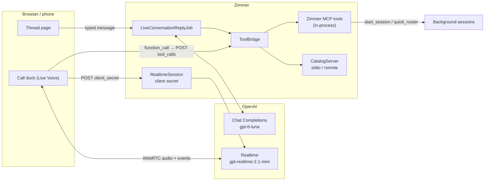

A session is an agent working on one job. Sometimes you want something else: to think out loud, ask
what is going on, and kick off work as it occurs to you, without writing a prompt for each piece.
That is what the live modes are for. Each is **one continuous conversation** with a fast model that
answers quick things itself and hands anything slower to Zimmer's own [MCP surface](/extend/mcp-server/).
It starts a background session, says that it has, and checks back on it when you ask.

| | Live Mode | Live Voice |
| --- | --- | --- |
| Turns | typed | spoken, answered out loud |
| Model | `gpt-6-luna`, Chat Completions, `reasoning_effort: "none"` | `gpt-realtime-2.1-mini`, Realtime API |
| Agent root | `live-mode` | `live-voice` |
| Where it runs | a job on the server | the browser's WebRTC or the phone's WebSocket connection to OpenAI |

Both are entered from the main screen: **Live Voice** and **Live Mode** beside **New Session**, or
the microphone button and the menu on a phone. `/live` has both, plus whether the OpenAI key is set.

## One conversation per mode

A mode has one current conversation. Opening a mode resumes it; **New conversation** ends it and
starts a fresh one. The database enforces this with a unique index over open conversations per mode,
so two starts racing cannot leave two current threads. Ended conversations stay readable.

A conversation is its own record (`LiveConversation`, with `LiveConversationTurn` rows), not a
[session](/sessions/lifecycle/). A session is an agent process: it is spawned, heartbeated, swept
when its start stalls, and reaped with its clone. A live conversation has no process for any of that
to manage. What it shares with sessions is what it delegates to them.

Its lifecycle is short: `preparing` while Zimmer reads its agent root's AGENTS.md, then `active`,
then `ended`. It goes to `failed` when the instructions cannot be read, and the reason is shown on
the page.

## The agent root is the system prompt

Each mode has an agent root in the catalog, `live-mode` and `live-voice`, whose **AGENTS.md is the
model's instructions**. Starting a conversation fetches that one file: a shallow, blobless clone with
no checkout, then `git show` of the file, with the same stall detection as a session clone
(`LiveConversations::RootInstructions`). CLAUDE.md is accepted when a root ships only that. The page
says which commit the instructions came from.

Zimmer appends a short section of its own about mechanics only it knows: the mode, the functions,
and the conversation's URL. A reconnecting voice call also gets a recap of the last thirty lines,
because a new Realtime session remembers nothing.

The root's default MCP servers are the conversation's starting tool set. If the catalog has no
`live-mode` or `live-voice` root, that mode is **off** and says so: on `/live`, on the mode's page, in
`GET /api/v1/live` and in `get_live_conversations`. It does not crash.

## The tool bridge

The model can call three kinds of function (`LiveConversations::ToolBridge`):

- **`zimmer(tool, arguments)`**, which calls one of Zimmer's own MCP tools in-process. This is the
  delegation path: `quick_router` or `start_session` to start work, `get_session` to check on it,
  `action_session` to follow up. It exists when the conversation has one of Zimmer's own catalog
  servers (`zimmer`, `zimmer-*`), scoped to the tool groups that server's URL names. It is one
  gateway rather than one function per tool because the default surface's definitions come to about
  200 KB, too much for a realtime model to carry on every turn. The gateway lists each tool in one
  line, and `describe_zimmer_tool` returns any tool's full schema.
- **`list_mcp_servers`, `enable_mcp_server`, `disable_mcp_server`**, through which the model manages
  its own catalog servers. This is the self-enable path.
- **`<server>__<tool>`**: every tool of every enabled non-Zimmer server, called directly.

### Delegating, and when not to

The agent root's AGENTS.md owns the policy. The intended shape, which Zimmer's own section repeats in
one line, is this: anything that takes more than about five seconds becomes a background session,
and the live model stays responsive. The sessions it starts are ordinary sessions on the board.

### Self-enabling a catalog server

When the live agent keeps reaching the same capability through a background session, it can call
`enable_mcp_server` with that server's catalog name and call the server's tools itself. That costs
one hop instead of a session. Enabling lists the server's tools once and keeps them on the
conversation (`mcp_tool_cache`), so building the function list never has to start the server. A
voice client is handed the new tool list and sends a `session.update`. Live Mode picks it up on its
next request. A conversation enables at most eight servers and exposes at most 80 direct tools.

The bridge runs on the server because nothing else can. Most catalog servers are `npx` stdio
processes or need credentials, and neither the browser nor OpenAI can run or hold those.

- **Remote servers** are reached with the URL, headers and OAuth token `McpServerEndpoint` resolves.
  These are the same ones MCP Apps uses.
- **Stdio servers** are spawned for one call and closed after it. Their environment is the server's
  own catalog `env` (interpolated through the secrets chain) plus `PATH`, `HOME`, `LANG`, `LC_ALL`,
  `TMPDIR` and `USER`. It is never the Rails environment, which holds the database password and every
  API key.

Every call is recorded as a `tool` turn with its arguments and output. The page shows it collapsed,
for example as `zimmer → quick_router`.

## Live Mode

A typed message becomes a `user` turn and enqueues `LiveConversationReplyJob` on the `inference`
queue. The job claims the conversation (`responding_since`, under a row lock), replays the last 80
turns to Chat Completions with the bridge's tools, and runs any function calls. It feeds the results
back and repeats until the model answers in words, giving up after eight rounds. A message typed
while a reply is running is answered by the same loop. Turns reach the page over Turbo Streams.
Nothing is stored at OpenAI: the thread is replayed from Zimmer's own rows every time.

## Live Voice

Audio never passes through Zimmer:

1. **Talk** asks Rails for a client secret (`POST /live_conversations/:id/client_secret`). Rails
   calls OpenAI's `POST /v1/realtime/client_secrets` with the whole session config: model,
   instructions, tools, `gpt-4o-mini-transcribe` transcription, `semantic_vad` turn detection, and
   the voice (`marin`, or `LIVE_VOICE_VOICE`). The secret lasts ten minutes and the real key never
   leaves the server.
2. The browser opens WebRTC to OpenAI with that secret: an SDP offer to `/v1/realtime/calls` and the
   `oai-events` data channel.
3. On `response.function_call_arguments.done` it relays the call to `POST tool_calls` and sends the
   output back as a `function_call_output` item. When that response's `response.done` arrives and
   every result is in, it sends exactly one `response.create`.
4. Finished transcript lines (`conversation.item.input_audio_transcription.completed` and
   `response.output_audio_transcript.done`) are posted as turns, so the thread on the page and in
   the API carries what was said.

The call is owned by a dock in the layout (`shared/_live_voice_dock`, `data-turbo-permanent`), not by
the conversation page. A Turbo navigation replaces the page body, and a peer connection living in it
would drop on every click. The dock keeps the call, its mute and hang-up buttons, and a link back to
the thread while you look around Zimmer.

## On the phone and in the car

The [iOS app](/extend/ios-app/) has both modes behind the session list's waveform button, over
the same REST routes. Live Voice on the phone opens a **WebSocket** to OpenAI rather than WebRTC.
It uses the `websocket_url` the client-secret call returns, sends 24 kHz PCM16 as
`input_audio_buffer.append`, and plays `response.output_audio.delta`. It relays function calls
and transcript lines exactly as the browser does: the shared rules are `RealtimeConductor` in
ZimmerKit. CarPlay offers *New conversation* and *Resume conversation* for Live Voice on the same
call, and stays dark until Apple grants the entitlement
([#1273](https://github.com/tadasant/zimmer/issues/1273)).

## The OpenAI key

Both modes need `LIVE_OPENAI_API_KEY`, resolved through the [secrets chain](/operate/secrets-parameter-store/)
(Parameter Store, Rails credentials, environment). Without it both modes are off, with that as the
stated reason. Zimmer does not write the key: set it in the secrets console that administers
Zimmer's store, as a secret parameter at `/zimmer/<env>/secrets/static/LIVE_OPENAI_API_KEY`, or with
the `gcloud` commands in [Adding a secret](/operate/secrets-parameter-store/#adding-a-secret). A new
value reaches Zimmer within a minute, with no redeploy. `/live`'s "OpenAI API key" panel shows
whether the key is set, which link of the chain holds it, and that path, and links the console when
`ZIMMER_STORE_CONSOLE_URL` is set. It shows no value and no fingerprint. See
[Secrets Zimmer itself depends on](/operate/secrets-parameter-store/#secrets-zimmer-itself-depends-on).
The key has its own name rather than `OPENAI_API_KEY` because store-resolved variables can reach session
environments, and Codex and Pi read `OPENAI_API_KEY` on their own. A key set for Live must not change
how those sessions authenticate or bill.

| Variable | Default | What it does |
| --- | --- | --- |
| `LIVE_OPENAI_API_KEY` | none | The key. Required. |
| `LIVE_MODE_MODEL` | `gpt-6-luna` | Live Mode's model |
| `LIVE_VOICE_MODEL` | `gpt-realtime-2.1-mini` | Live Voice's model |
| `LIVE_VOICE_VOICE` | `marin` | Live Voice's voice |
| `LIVE_OPENAI_BASE_URL` | `https://api.openai.com/v1` | An OpenAI-compatible endpoint instead |
| `ZIMMER_STORE_CONSOLE_URL` | none | The console over Zimmer's own store, linked from the key panel. Unset, the panel shows the path without a link |
| `ZIMMER_STORE_CONSOLE_STORE_NAME` | none | What that console calls the store, shown beside the link |

## From an agent or a script

- **MCP:** `get_live_conversations` (whether each mode can start, recent conversations, one thread)
  and `action_live_conversation` (`start`, `send_message`, `finish`). Both are in the opt-in
  `live_conversations` group, which nothing carries by default: a live model can reach the whole
  catalog, so a session must not be able to steer one just by holding `sessions`. See
  [the MCP server](/extend/mcp-server/).
- **REST:** `/api/v1/live` and `/api/v1/live_conversations`. An API key may read them. Starting,
  messaging, finishing and the voice relay take the iOS app's sign-in acting as you, for the same
  reason. See [the REST API](/extend/rest-api/#live-conversations).
- **Supervisor:** `/supervisor/live_conversations` and `/supervisor/live_conversation_turns`, both
  read-only.

What is not proven yet, and the known rough edges, are on [Known limitations](/limitations/).
