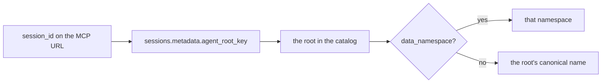

A session ends and its context goes with it. Some roots need to remember things across sessions: a
cursor, run history, notes about a PR they keep coming back to. **Root data** is a small document
store for that, one per agent root. Whatever a root's sessions write there, every later session of
the same root can read.

It is not a database per root. Every root's records live in one table, `agent_root_records`, and a
root gets "its own tables" by declaring **collections** in the catalog. Zimmer never runs DDL at
runtime. The production Postgres is one small node with a fixed connection budget, and every table
the app has is in `db/schema.rb`.

## Declaring collections

A root opts in with two optional fields on its catalog entry:

```json
"my-root": {
  "name": "my-root",
  "url": "https://github.com/me/repo.git",
  "data_namespace": "my-root",
  "data_collections": {
    "notes": {
      "description": "Things worth remembering between sessions",
      "schema": { "type": "object", "required": ["title"] },
      "retention_days": 90
    },
    "runs": {}
  }
}
```

| Field | Meaning |
| --- | --- |
| `data_namespace` | The namespace this root's records live under. Defaults to the root's short name. Two roots that resolve to the same value share one store, and that includes a `data_namespace` equal to another root's name. Lowercase letters, digits, `.`, `_` and `-`. Pin it if the root's data must survive the root being renamed. |
| `data_collections` | The collections the root may write. Each key is a name (`[a-z][a-z0-9_-]*`). |
| `…schema` | A JSON Schema every written record's `data` must match. Optional; omitted means any JSON object. Remote `$ref`s are not fetched. |
| `…retention_days` | Records not written for this long are deleted automatically. A `put` that replaces a record restarts its clock. Optional; omitted means a record stays until it is deleted. Capped at 3650. |
| `…description` | Shown by `list_root_collections`. |

A bare list (`"data_collections": ["notes", "runs"]`) declares those names with nothing set.

The root also needs the MCP server. `zimmer-root-data` (`?tool_groups=root_data`) carries reads and
writes, and `zimmer-root-data-readonly` (`?tool_groups=root_data_readonly`) carries reads only. Add
one to the root's MCP servers.

### Undeclared collections are refused on write

Writing to a collection the root does not declare is an error, not an implicit create. The catalog
is the one place a root's data shape is written down, so a typo in a collection name fails loudly
instead of quietly starting a second collection.

Reads are the other way round. They never consult the declarations, so a collection that has
records but has since been dropped from the catalog is still listed, still searchable, and still
deletable.

### The catalog is read on write, and only then

`AirCatalogService` can serve a last-known-good snapshot older than the catalog on `main`. That
snapshot can affect a write: the schema it checks against and the retention it stamps. It can never
change a record already stored. A record's expiry is fixed in `expires_at` when the record is
written, and the retention sweep reads that column and nothing else. Shapes the reader does not
understand (an entry that is not an object, a non-numeric `retention_days`, a malformed name) are
skipped rather than raised on, so an older catalog degrades to "not declared".

## The tools

`root_data` is an [opt-in tool group](/extend/mcp-server/). The unscoped `/mcp` surface does not
carry it.

| Tool | Does |
| --- | --- |
| `list_root_collections` | The namespace, the limits, and each declared or stored collection with its schema, retention and usage |
| `search_root_records` | One collection, optionally filtered by **JSON containment** (`{"status": "open"}` matches records whose `data` contains that), ordered `newest`, `oldest` or `recently_updated`, paged with `limit`/`offset` |
| `get_root_record` | One record by `key` or `id` |
| `put_root_record` | Insert or replace the record at `key` (write) |
| `append_root_record` | Insert a keyless record (write) |
| `delete_root_record` | Delete one record by `key` or `id` (write) |

There is no SQL. The containment filter is served by a GIN `jsonb_path_ops` index on `data`.

## How the namespace is chosen

No tool takes a namespace. The server resolves it from the calling session:



`RuntimeConfigPostProcessor` stamps `session_id` onto every Zimmer MCP entry it writes into a
session's config, which is where the session id comes from. The router's deprecated alias,
`zimmer-router`, resolves to `zimmer-orchestrator`, both its config and its name.

The tools refuse rather than guess when:

- the connection names no session, or a session that does not exist;
- the session has no `agent_root_key`;
- the root is not in the catalog;
- the resolved namespace is not valid (a malformed `data_namespace`).

They never fall back to matching the session's repository the way
`AgentRootsConfig.find_for_session` does, because several roots share a repository and that match
would hand one root's data to another.

## Isolation is best-effort

The namespace comes from the server, and an agent that calls the tools as offered only ever reaches
its own root's records. That is a **scoping** boundary, not an authorization one, like every tool
group on this endpoint. The MCP API key is shared by the whole fleet, and `?session_id=` is a
default the caller could rewrite: a session that built its own URL naming another session's id
would reach that session's root's namespace.

What holds regardless: every write stamps `writing_session_id` from the connection, so who wrote a
record is on the record. Do not put secrets or anything sensitive in root data until the endpoint
can authenticate which session is calling (see [Limitations](/limitations/#root-data-isolation-is-a-scoping-boundary-not-an-authorization-one)).

## Limits

Fixed in `RootData::Limits`. They protect the shared database, so a root cannot raise them from its
own catalog entry.

| Limit | Value |
| --- | --- |
| Serialized `data` per record | 32 KB |
| Records per collection | 10,000 |
| Collections per namespace | 25 holding records; an emptied collection frees its slot |
| Writes per collection | 60 a minute (fixed window; put, append and delete all count) |
| Key length | 200 characters |
| Search page | 20 by default, 100 max, and it stops early at about 200 KB of record data with `truncated: true` |

The row cap and the rate limit are read from `agent_root_record_counters`, one row per
(namespace, collection), never from `COUNT(*)`. Every write locks that row first, then touches
records, in one transaction. That serializes writers to a collection, so the caps hold under
concurrency. The retention sweep takes the same locks in the same order.

## Retention and visibility

`RootDataRetentionJob` runs hourly at :35. It deletes records whose `expires_at` has passed, a
batch at a time inside a 60-second slice, and decrements the counters in the same transaction. Its
selector is a partial index on `(expires_at, id) WHERE expires_at IS NOT NULL`, so collections
with no retention are never scanned. Each tick then recounts up to 25 of the counters that have
been quiet longest, under their locks, so a counter that drifted puts itself right.

None of this needs a shell:

- **`/health`** has a Root Data panel with per-namespace records, bytes and last write, any
  expired records more than two hours past due (the sweep is behind), and collections at 90% or
  more of the row cap.
- **`GET /api/v1/health`** and **`get_system_health`** carry the same object as `root_data_health`.
- **`/supervisor/agent_root_records`** and **`/supervisor/agent_root_record_counters`** list the
  rows themselves, read-only. Writes go through the tools, because a row edited around
  `RootData::Store` would skip the caps and the counters.
