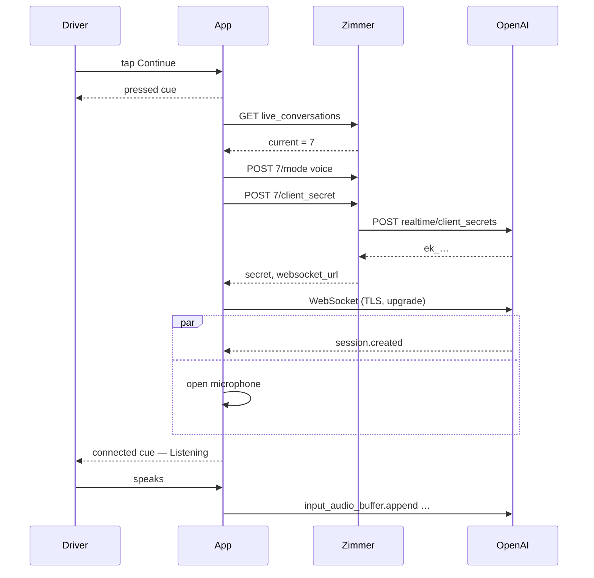
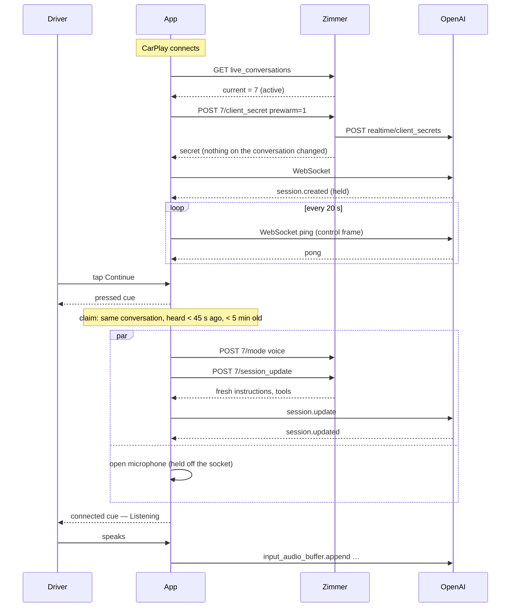
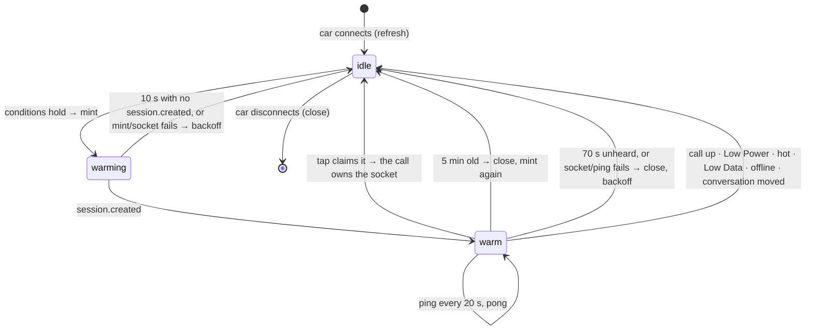

# CarPlay pre-warm

The goal is to start a Live Mode call from the car in under a second instead of two to three. While
CarPlay is connected and no call is up, the app holds one Realtime connection ready for **Continue**.
The tap starts the call on that connection.

It is **on by default, with no flag**: Tadas asked for the flag to come out (see
[Rollout and the missing off switch](#rollout-and-the-missing-off-switch)). This file is the design
and the numbers behind each constant. The user-facing prose is
[docs: CarPlay pre-warm](https://docs.zimmer.tadasant.com/sessions/live/#carplay-pre-warm). The rest
of the car is [`CARPLAY_DESIGN.md`](CARPLAY_DESIGN.md).

## Where the time goes today

A cold Continue does this, one step after another, before the *connected* notes:

| Step | Rough cost on cellular |
| --- | --- |
| `GET /api/v1/live_conversations`: which conversation is open | 0.15–0.3 s |
| `POST …/mode`: voice on | 0.15–0.3 s |
| `POST …/client_secret`: Zimmer builds the instructions and asks OpenAI for a secret | 0.4–1.0 s |
| WebSocket to OpenAI: DNS, TCP, TLS, upgrade | 0.2–0.5 s |
| OpenAI's `session.created` | 0.2–0.5 s |
| Microphone and audio session, alongside the socket | 0.2–0.4 s |

The pre-warm moves the lookup, the mint, the handshake and `session.created` to before the tap. What
is left at the tap is the microphone, run alongside voice-on and one `session.update` round trip. The
expected tap-to-ready is **under 1 s** on a warm hit, down from **2–3 s**. These are estimates.
`call.startup` measures the real numbers (see [Measuring it](#measuring-it)).

This is the app's half. It composes with the server's pre-warming: `WarmClonePool` and
`WarmProcessPool` keep a Claude Code process booted for the Quick Router (sessions 24689, 24914, and
the latency study 24697). That speeds up what a call *delegates*; this speeds up the call itself.
Both follow the same two rules: no inference while warm, and the person's own first input is the
first thing the warm thing ever sees.

## Can the provider hold an idle connection for free?

Yes, as far as the billing model goes. OpenAI bills Realtime by tokens: audio and text in, audio and
text out. A session with no `input_audio_buffer.append`, no `conversation.item.create` and no
`response.create` produces none. The instructions count as input tokens only when a response
runs. Minting a client secret is free.

What a warm connection costs is one mint every 5 minutes, one socket, and a WebSocket ping every
20 s. **This has not yet been checked against a real bill.** The first drives should compare the
OpenAI usage page with the `warm.ready` count. If the idle
session turns out to cost something, the fallback is the token-free subset, which needs no code
change: cut `maxAge` to the secret's own lifetime and keep the socket closed. That keeps only the
pre-read lookup.

## Architecture

```
ZimmerKit (Foundation only, tested on Linux)
  LiveWarmStart        the state machine: what to do and when; no I/O
  LiveEvent.warm*      the telemetry events; call.startup, call.first_audio
  LiveAPI              livePrewarmSecret(id); LiveOverview.currentIsReady

App (iOS)
  LiveWarmKeeper       drives LiveWarmStart: ticks, reads Zimmer, mints, pings, closes;
                       watches the call, Low Power Mode, the thermal state, the network
  LiveWarmLink         one warm socket: open, read, ping, close. No way to send an event
  LiveCall.startWarm   the tap: adopt the socket, voice on + session.update, open the microphone
  CarPlaySceneDelegate carConnected / carDisconnected
  CarPlayLive          Continue skips the lookup only when a warm connection is held for the
                       open conversation, and asks for a warm start

Rails
  POST /api/v1/live_conversations/:id/client_secret  prewarm=1: mint, change nothing (CarPlay only)
  POST /api/v1/live_conversations/:id/session_update model=: record the warm call's model
```

## Sequences

### Cold start (no warm hit)



### Warm start



If voice-on or `session_update` fails, the warm socket fails, or no `session.updated` comes within 3 s, the call falls back: it closes the warm socket, mints cold
and opens a new socket on the microphone that is already open. There is no second tap, and
`call.startup` says `path=fallback`.

## The warm session's states



`LiveWarmStart` is this diagram in code, and `LiveWarmStartTests` drives it.

## The hard rule: nothing before the tap

Nothing user-originated and nothing billable goes up a warm connection before the driver taps.

- **Structurally.** `LiveWarmStart.Action` is `refresh`, `mint`, `ping` and `close`, with no case
  that sends. `LiveWarmLink` has no method that sends an event. The only way a warm socket reaches
  something that can send is `LiveWarmKeeper.claim`, which `LiveCall.start` calls for the
  driver's tap on Continue. The car's quiet retries of that same tap (`LiveRetry`) can claim too.
- **No microphone.** Nothing in the warm path touches `AVAudioSession` or the engine. The
  microphone opens in `startWarm`, after the tap, exactly as in a cold call.
- **Held until fresh.** After the tap, microphone frames (and the watchdog's silence) stay off
  the socket until OpenAI answers the fresh `session.update` with `session.updated`, within 3 s.
  The *connected* notes wait for that too. Nobody is told to talk while the session is on the
  warm-up's instructions, or into a socket that died quietly. A socket that fails here, or no
  `session.updated`, sends the start to the cold fallback rather than dropping the call.
- **The server agrees.** A prewarm mint notes no client, sets no `car_call`, writes no model, and
  needs no voice on, so the conversation the person sees does not change. Zimmer refuses it from
  any client but the car. The tap's `session_update` carries the warm
  secret's model, so the conversation still records the model the call ran on. Tested in `live_conversations_controller_test.rb`.
- **No UI.** Nothing is shown, played or asked. The car's screens are unchanged.

## Reusing a session that is already up

A call already up is the session. A tap while one runs carries it on (`LiveCall.carryOn`), as
before. The keeper holds nothing while a call is up (`Hold.callActive`). When the call ends with
the car still connected, it reads what is open and warms for the next tap.

## Timeouts, heartbeat, reconnection

| | Value | Why |
| --- | --- | --- |
| Tick | 1 s | Cheap; every rule is a comparison |
| Refresh | 30 s | Follows the open conversation |
| Heartbeat | 20 s ping | Inside carrier NAT idle timeouts (30 s to minutes) |
| Warming deadline | 10 s | A cold call does all of it in 2–3 s |
| Stale | 45 s unheard | Not handed to a call; it starts cold |
| Dead | 70 s unheard | Closed, then backoff |
| Max age | 5 min | Model, voice and effort are fixed at mint; this bounds how stale they get |
| Backoff | 5, 15, 60, 120 s | One per failure in a row; a success resets it |
| Budget | 15 mints per car connection | About 75 minutes of an untouched home screen |
| Suspended | tick gap > 5 s | Ping and refresh at once on waking |

## Mobile constraints

- **Battery.** One socket at most. It is idle except for a ping every 20 s, and there is no audio
  session. Nothing is warmed on Low Power Mode.
- **Thermal.** Nothing is warmed at `.serious` or `.critical`.
- **Network.** Nothing is warmed on Low Data Mode (`NWPath.isConstrained`) or with no path. A
  path change re-evaluates at once, and the next ping finds a socket that died on a cell handover.
- **Background execution.** No background task, no background mode beyond what the app already
  has. If iOS suspends the app while the CarPlay scene is behind another app, the socket may die.
  The tick gap makes the keeper ping and refresh on waking, and a tap more than 45 s after
  anything was heard starts cold.

## Caching

- **In memory only.** The last read of what is open (for 30 s; it skips a tap's lookup only
  when it names the conversation a warm connection is held for), and the warm socket.
  The warm socket *is* the cached model and voice config: OpenAI has already applied the session
  config Zimmer chose, which is why `maxAge` bounds its staleness. **Nothing new is written to
  disk.** The secret is never persisted.
- **Assets.** The car's only assets are SF Symbols and the cues, which are synthesized in memory
  in under a millisecond. There is nothing worth pre-loading, so nothing is.

## The cold-start fallback

The cold path is unchanged and remains the default. A tap is cold when:

- a hold applies;
- the choice is **New**, because a conversation that does not exist yet cannot be warmed;
- the tap comes while the connection is still warming;
- the warm connection is for another conversation, stale, or too old;
- the call is coming back from the gear, which must be minted from the row the panel wrote.

A warm start that fails after the claim falls back to cold within the same start
(`path=fallback`).

## Measuring it

Every call logs these to the shipped call log (`scope.name:="ios.live"`). The LogsQL is in
[docs: observability](https://docs.zimmer.tadasant.com/operate/observability/#the-ios-apps-call-log).

| Metric | Event | Field |
| --- | --- | --- |
| Tap to ready, p50/p95, by path | `call.startup` | `tap_to_ready_ms`, `path` |
| Tap to first model audio | `call.first_audio` | `since_tap_ms`, `path` |
| Warm-hit rate | `warm.claimed` / (`warm.claimed` + `warm.missed`) | `reason` on a miss |
| Fallback rate | `call.startup path=fallback`, `warm.fallback` | `message` |
| Connection success/failure | `warm.ready`, `warm.failed`, `warm.closed` | `since_mint_ms`, `reason` |
| Cost exposure | `warm.ready` count, `warm.closed` `age_ms` | warm minutes per drive |
| Why nothing warmed | `warm.held` | `hold` |

`call.startup` is logged for cold calls too, from the phone and the car. Phone calls and cold
car calls are the baseline.

## Privacy and security

- **Short-lived, scoped credentials.** A prewarm secret is the same ten-minute OpenAI client
  secret as a call's, minted by Zimmer with the session config Zimmer chose. The phone never holds
  the OpenAI key. It is held in memory only and dropped with the socket.
- **Same access as a call.** The prewarm mint takes the app's person-acting sign-in, like every
  Live write. An API key cannot mint one.
- **No audio before the tap.** No microphone, no capture, no upload. The instructions in the warm
  session (the recap of the thread) are what any call would carry, sent to OpenAI by Zimmer. They
  are replaced at the tap.
- **Nothing at rest.** No new on-disk state.
- **Telemetry** carries names, reasons and timings, never content, as the call log always has.

## Rollout and the missing off switch

There is no flag. The first version of this change put it behind a Live setting, off by default, with a rollout
from internal use to default-on. Tadas then asked for the flag to come out and the feature to be
on by default. His words, by CarPlay voice, relayed through router session 27704:

> "remove the feature flag for this CarPlay pre-warm work, enable the feature by default, and
> proceed to merge when implementation and checks are complete. Do not wait for an approval gate
> unless the system requires it. If any blocking risk or policy constraint prevents this, report it
> and propose the closest compliant approach."

**The risk this leaves.** The warm path has never run in a car or against OpenAI. With no flag,
nothing turns it off without a code change: a server deploy that refuses prewarm mints, or a
new app build (see "Turning it off" below). What bounds the damage in the meantime:

- **Every failure already falls back to cold.** A mint, a socket or a `session.updated` that fails
  sends the tap down the old path on the same microphone, with no second tap. The worst a broken
  warm path should cost is the latency it was meant to save, plus up to 3 s waiting for
  `session.updated`.
- **The holds and the budget still apply.** One connection at most, backoff after failures, 15
  mints per drive, and nothing on Low Power Mode, heat, Low Data Mode or no network.
- **The telemetry says so at once.** `call.startup` by `path`, `warm.fallback` and `warm.failed`
  show within a drive whether the warm path is helping or hurting.

**How to judge the first drives.** Over the first week or about 20 car calls, look for: warm p50
tap-to-ready **< 1.0 s** and p95 **< 2.0 s**, a warm-hit rate **≥ 70 %**, fallbacks **< 5 %**, no
rise in `call.failed`, and no idle-session cost on the OpenAI usage page.

**Turning it off.** There are two levers, and neither is a setting:

- **Stop the mints, with a server deploy and no app build.** Make
  `LiveConversations::Actions#prewarm_secret` refuse every request. Each car's mints then fail.
  Each failure costs one request and backs off (5, 15, 60, 120 s), and the per-drive budget caps
  them at 15. With no warm connection, `freshCurrent` answers nil and every tap takes the cold
  path exactly as before. This is the emergency lever.
- **Stop it in the app, with a new build.** Remove the `LiveWarmKeeper.shared.carConnected()`
  call in `CarPlaySceneDelegate`. The keeper then never starts, and `freshCurrent` and `claim`
  both answer nil. The cold path never changed shape: it is the `allowWarm == false` path of
  `LiveCall.start`.

## Later

- **Wait for a warming connection.** A tap during warming currently starts cold. It could
  instead await the mint already in flight.
- **Pre-read for New.** Warm the network and Zimmer's side for a new conversation without
  creating it.
- **Settings-aware replacement.** Replace a warm connection as soon as the Live settings change,
  instead of within 5 minutes. This needs a settings version on the refresh.
